# Vini Word Game — Software Architecture Design (v1)

| Item | Value |
|---|---|
| Status | **Decisions 1–10 approved 2026-10-31 (see Approval Log). Nothing here is implemented or committed.** |
| Source | `Vini_Word_Game_Architecture_Design_v1.md` (authoritative brief, unmodified) |
| Platform | Android, Java only (no Kotlin), Android Studio, SQLite, JSON, AdMob |
| Date | 2026-10-31 |

**Status legend used throughout**

- **[APPROVED]** — stated in the brief; not changed here.
- **[RECOMMENDED]** — my proposal. Not approved until you say so.
- **[TBD]** — missing/ambiguous in the brief. Not assumed. Where a default is suggested it is labelled as a recommendation.

---

## Approval Log

**2026-10-31 — Decisions 1–10 of §28 approved by the project owner.** Each is now **[APPROVED]** in the form recommended in this document; the TBD register (§25) is updated accordingly.

| # | Approved decision | Resolves | Remaining follow-up |
|---|---|---|---|
| 1 | Hosted JSON to be verified; §5 schema accepted as the working proposal | T1 | The four URLs could not be fetched during design. Verification against the real files is a **Phase 0 task**; any mismatch is handled in the `LevelCodec`/envelope and reported before implementation proceeds. |
| 2 | Strict all-or-nothing import per game file | T16 | — |
| 3 | Progress kept on content change; removed levels keep progress rows; new `levelId` required to force a replay | T17, T23, §9.3 | — |
| 4 | Bundled `app_config.json` for **deployment configuration only** (no remote config in v1); bundled content at `assets/games/<lang>/`. **Revised — see below.** | T15 (layout) | Language-selection UX remains open (v1 uses `activeLanguage`). |
| 5 | Keyboard semantics: consumable keys (`keyReuse=false`), `shuffle=FULL`, joined-string answer equality accepted | T6, T7, T8 | Base keyboard content (distractors) is still a content task. |
| 6 | Ad counter per game, first-time completions only, optional cooldown | T10 | Cooldown **value** and **UMP consent / child-directed treatment (T11)** still open; T11 blocks store release. |
| 7 | Minimal non-game UI strings permitted in `strings.xml` | T13 | Home button title text/language still to be supplied. |
| 8 | SQLiteOpenHelper (no Room), `org.json`, `HttpURLConnection`, own image cache; portrait lock; minSdk 24; targetSdk per Play requirement at release | T2 (partly), T14, T24 | Exact `targetSdk`, Gradle/AGP versions and final `applicationId` still to be fixed in Phase 0. |
| 9 | Game 3 bundled images via `image.asset`; https absolute image URLs | T12 (partly) | Image host, relative-URL rule, size/count caps and prefetch policy still open. |
| 10 | Game 4 target words as token lists with optional positions; reverse selection allowed (`allowReverse=true`). **Also approved: the recommended score/stars/attempts/unlock defaults** — attempts-based stars via `ScoringPolicy`, sequential unlock, completed levels replayable | T9, T3, T4 | Exact star thresholds and the "all levels completed" screen still need definition before the progress/game phases. |

**Revision to decision 4 (2026-10-31, later the same day).** The owner decided that game **content and per-game settings must not be placed in `app_config.json`**. After discussion:

- **Option C approved:** every game's JSON carries a **file-level `settings` block** (once per file, never per level) next to `levels`. It is validated and imported into SQLite in the same transaction as the levels, so it is versioned, hashed, rolled back, bundled and updated remotely exactly like content, with **no new URLs**.
- **What moved out of `app_config.json`:** the Games 2/3 24-key keyboards (with `rows`, `columns`, `shuffle`, `keyReuse`) — and, per the owner's answer to "should the Game 1 animation and Game 4 directions stay in `app_config.json`?" (**No**), also the **Game 1 animation** and the **Game 4 settings** (allowed axes, reverse selection, grid sizes, word-count range). *Interpretation recorded here; please confirm it matches your intent.*
- **What stays in `app_config.json`:** deployment configuration only — active language, per-game JSON URLs, bundled-content path, AdMob unit IDs, ad cadence/cooldown, sync parameters.
- Sections revised: §3, §4 (rewritten), §5, §6, §7, §11, §12, §13, §22, §23 (ADR-011/012/013), §25 (T25 added), §26 (risk 21), §27, §28. A defect in the earlier Game 1 sample level 2 (token multiset ≠ correct order) was also fixed.

Decisions 11–12 of the review list (see §28) were not part of this approval and remain open or unchanged. Items T5, T18–T22 in §25 remain open.

---

## 1. Requirements Analysis

### 1.1 Explicitly agreed requirements [APPROVED]

| # | Requirement |
|---|---|
| R1 | Multilingual word-game app; Telugu first; Hindi, Tamil, Kannada and others later. |
| R2 | Java, Android Studio, SQLite local DB, JSON remote content, AdMob. Kotlin forbidden. |
| R3 | Strongly data-driven. No game content in Java. Only the **home-page game button titles** may be hardcoded user-facing content. |
| R4 | Language-neutral engine. No `if (language == ...)` logic. Playable units are Java `String` tokens, never `char`. |
| R5 | Home page lists games; initially 4: Word Rearrangement, Text Q+A, Image Q+A, Word Search. Adding games later must have minimal impact. |
| R6 | Flow: Remote JSON → download → validate → parse → SQLite → engine. No repeated JSON parsing during play. |
| R7 | One JSON URL per game (four URLs listed in the brief). Not one shared content URL. URLs configurable, not scattered in Java. |
| R8 | Bundled JSON (≥ 2 levels per game) in `assets/` = initial content + offline fallback; imported to SQLite on first launch. |
| R9 | Import: validate → parse → SQLite transaction; failed import leaves existing valid content intact; progress preserved. |
| R10 | Game 1: drag/drop token rearrangement; animation is **per-game configuration, not in level JSON**. |
| R11 | Game 2: text question, answer placeholders, 24-key keyboard (3 rows × 8 columns). Keyboard configured **once**, not in level JSON; level JSON gives answer tokens only; answer tokens are injected into the base keyboard at runtime. |
| R12 | Game 3: same as Game 2 with an image question. Image reference is data-driven. |
| R13 | Game 4: word search; grid stored in JSON (not generated); 8×8 / 10×10 / 12×12; ~4–6 target words; draw a line; horizontal + vertical initially; diagonal optional/future without redesign. |
| R14 | Configuration (URLs, language, AdMob IDs, G1 animation, G2/G3 keyboard, G4 settings) is separate from content (levels). |
| R15 | SQLite stores content **and** player progress, normalized; no mega-table. Progress separate from JSON, keyed by stable `gameId` + `levelId`, independent per game. |
| R16 | Independent per-game content versions; check for updates before downloading large files; consider version, hash, HTTP caching. |
| R17 | Defined behavior for new / changed / removed / reordered levels and removed games. |
| R18 | Image handling: URL from JSON, download, local cache, offline, invalidation, versioning, missing-image handling, storage location, memory. |
| R19 | AdMob: interstitial on game selection; interstitial after every 3 completed levels in a game; banner on game screen; central `AdManager`; IDs from configuration. |
| R20 | Layered architecture (UI → controller → rules → repository → DAO); UI never touches SQLite; game logic has no networking or AdMob code. |
| R21 | Error handling, DB transactions, DB migrations that preserve progress, security (HTTPS, validation, JSON never executable), performance, offline play, testing, 10 Mermaid diagrams, ADR-001…013, non-goals, risks. |

### 1.2 Technical constraints

- Java only; avoid unnecessary third-party dependencies (development rules).
- Telugu text as Unicode; **one displayed character ≠ one Java `char`**.
- Unknown / not yet specified: `minSdk`, `targetSdk`, `applicationId`, build tooling versions — see TBD register. "Approved Android configuration" is referenced in the working instructions but not defined in the brief.

### 1.3 Components proposed by the brief (assessed in §3, §13)

Main/Home Activity, Game Navigation, Game Factory/Registry, per-game Controllers, Game Rules, Keyboard Generator, Content/Progress Repositories, JSON Parser/Validator, Content Sync Manager, SQLite Helper + DAOs, Image Manager, Configuration Manager, Ad Manager. All are adopted; no unnecessary extras added (a few small supporting classes are listed explicitly in §3 and justified).

### 1.4 Decisions still needed (summary — full register in §25)

Progress/score/stars formulas; level unlocking; duplicate-key policy for keyboards; answer comparison rule; Game 4 reverse-selection and target-word format; interstitial counter semantics and cooldown; hosting of Game 3 images and bundled images; UI language for non-game text; orientation; minSdk/targetSdk; consent (UMP) and child-directed ad treatment; language selection UX.

### 1.5 Ambiguities and inconsistencies found in the brief

| # | Finding | How this document handles it |
|---|---|---|
| A1 | **Game 3 URL is different in shape** (`telugu/game3/game3.json`, a subfolder) while others are `telugu/gameN.json`. Likely images live beside it, but relative-image resolution is not stated. | Support absolute HTTPS image URLs (as in the brief's example). Relative URLs resolved against the Game 3 JSON URL — **[TBD]** whether allowed. |
| A2 | **I could not fetch the four remote URLs** from this environment (tool restriction), so the real hosted JSON structure is **unverified**. They may already use a different shape than §5. | Schema in §5 is a **proposal**. Before implementation the hosted files must be checked/adapted — **[TBD, blocking for the content phase]**. |
| A3 | Game 1 sample has `tokens` identical to `correctOrder` (already solved) and `answer` duplicates `correctOrder`. | Engine always shuffles at runtime and guarantees the start order ≠ solution. Validator checks `join(correctOrder) == answer` and token multiset equality. |
| A4 | The brief says "Game 1 Animation = BOUNCE" but does not say *when* (on correct? on drop? on completion?) nor whether wrong-order has any animation. | **[TBD]**. Config models a single animation type per game; trigger = level completion (recommended). |
| A5 | Game 2/3 base keyboard sample contains only vowels/consonants, but answer tokens are conjunct/syllable units (`చం`, `మా`). After replacement, the answer tokens visually stand out from base keys. | Recommend full shuffle and a base keyboard that includes realistic distractor syllables (§11). Flagged as a content/config risk. |
| A6 | Duplicate answer tokens: is a key consumed when tapped, or reusable? Not stated. | Algorithm supports both via config flag; default **[TBD]** (§11). |
| A7 | "Answer tokens already in base keyboard" — keep, replace, or duplicate? | Recommended: keep the existing key as satisfying one occurrence; never create a second copy unless the answer needs one (§11). |
| A8 | Game 4 "optional target positions/directions" — optional, but then how are words validated? Also, target words as plain strings cannot be reliably split into tokens. | Target words are stored as **token lists**; matching is content-based; positions optional (§12.4). |
| A9 | Reverse reading (right→left / bottom→top) not mentioned. | **[TBD]**; config flag `allowReverse`. |
| A10 | "Interstitial after every 3 completed levels **in a game**" — per-game counter or global? Do replays count? | Recommended: per-game counter of *first-time* completions (§16). **[TBD]**. |
| A11 | Brief says hardcoded UI content is limited to game button titles, but a real app also needs labels (e.g., "level complete", "no internet", retry). | **[TBD]**: Recommend minimal `strings.xml` chrome strings be explicitly permitted. Not assumed approved. |
| A12 | Bundled asset layout in brief (`assets/games/game1.json`) is not language-aware. | Recommend `assets/games/te/game1.json` etc. (§4). Minor deviation — needs approval. |
| A13 | Game 3 offline first run: bundled levels need **bundled images**, otherwise offline fallback is incomplete. | Recommend bundled image assets referenced by an `image.asset` field (§5.4). **[TBD]**. |
| A14 | AdMob App ID must live in `AndroidManifest.xml`, so it cannot come purely from runtime configuration. | App ID via Gradle manifest placeholder; ad *unit* IDs from config (§16). |
| A15 | Brief says JSON must not repeat configuration, but also says JSON has "game metadata". | Metadata = identity/version only (`gameId`, `gameType`, `language`, `contentVersion`, `schemaVersion`). No behavior config. |
| A16 | Score, stars, attempts, level unlocking, "current level" semantics undefined. | **[TBD]**; storage supports them; recommended definitions in §9. |

---

## 2. Architecture Overview

### 2.1 Principles

1. **JSON is the remote distribution format; SQLite is the runtime store and progress store; Java is a language-neutral engine.** [APPROVED]
2. Deployment configuration ships in the app (`app_config.json`); per-game settings (animation, keyboard, search rules) ship inside each game's JSON as a file-level `settings` block, never per level; level content comes from the same JSON. [APPROVED, revised 2026-10-31]
3. Pure-Java rules layer (no `android.*` imports) so rules are unit-testable on the JVM. [RECOMMENDED]
4. Dependencies down only: UI → Controller → Rules/Repository → DAO/Network. No upward references.
5. Everything at a layer boundary uses immutable model objects.

### 2.2 Selected layering [RECOMMENDED]

```
Presentation   (Activities, custom Views)           android.* allowed
     │
Game/Application layer (GameController per game)    orchestrates; talks to Repositories, AdManager via interfaces
     │
Game Rules / Domain (pure Java)                     ordering, answer validation, keyboard gen, word match
     │
Repository     (ContentRepository, ProgressRepository, ConfigRepository-ish ConfigManager)
     │
┌────┴──────────────┐
SQLite (DAOs)     Network (HTTP + image)  ──► JSON validator/parser ──► importer
```

Rationale: this is the layering of the brief (§24/§25) with two refinements: (a) the sync pipeline (`content` package) sits beside the repository rather than inside games, so no game class ever sees networking; (b) a plain controller ("presenter-style") pattern instead of MVVM, to avoid Jetpack ViewModel/LiveData dependencies. State survives rotation by locking portrait **[TBD, recommended]** plus `onSaveInstanceState`.

### 2.3 Technology choices (all [RECOMMENDED] unless noted)

| Concern | Choice | Reason |
|---|---|---|
| DB access | `SQLiteOpenHelper` + hand-written DAOs (framework SQLite) | SQLite is approved; Room would add a dependency + annotation processor with little benefit at this size. |
| JSON | `org.json` (in the Android framework) | No dependency. Files are small and size-capped (§19). Streaming `JsonReader` is the fallback if files grow. |
| HTTP | `HttpURLConnection` | No dependency; need only GET with conditional headers. |
| Images | Own `ImageManager` (`BitmapFactory`, `LruCache`, files) | Avoids Glide/Picasso. Scope is a single image per level. |
| Threading | `java.util.concurrent.Executors` + main `Handler` | No coroutines/RxJava; no WorkManager needed in v1. |
| Dependency wiring | Manual: `ViniApplication` owns an `AppContainer` | No DI framework needed for ~25 classes. |
| UI | AndroidX AppCompat + framework views; custom `View`s for drag grid / word grid | Standard; minimal. |
| Ads | Google Mobile Ads SDK (AdMob) | Approved. |
| Test-only | JUnit 4; `org.json:json` as `testImplementation` (the stubbed `android.jar` `org.json` doesn't work in JVM tests); AndroidX Test for instrumented DB/UI tests | Flagged because it is a dependency, test-scope only. |

---

## 3. Java Package and Class Structure

Base package: `com.example.wordgames` per the brief — **final `applicationId`/package [TBD]**.

```
com.example.wordgames
├── ViniApplication                 builds AppContainer, initializes ads, triggers startup sync
├── AppContainer                    manual service locator (singletons: config, db, repos, sync, ads, executors)
│
├── ui
│   ├── home        HomeActivity, GameButtonAdapter(or simple builder)
│   ├── game        GameHostActivity, GameScreen (interface), LevelCompleteView
│   └── common      TokenView, ErrorView, LoadingView
│
├── game
│   ├── common      GameModule, GameRegistry, GameController, GameCallbacks, LevelResult,
│   │               ScoringPolicy, KeyboardGenerator, KeyboardLayout, KeyboardState,
│   │               TokenSequenceMatcher, TokenSequence, AnimationType
│   ├── game1       Game1Module, Game1Controller, Game1View, RearrangeRules, Game1Level
│   ├── game2       Game2Module, Game2Controller, Game2View, KeyboardAnswerRules, Game2Level
│   ├── game3       Game3Module, Game3Controller, Game3View, Game3Level   (reuses KeyboardAnswerRules)
│   └── game4       Game4Module, Game4Controller, Game4View(GridView), WordSearchRules,
│                   Direction, GridPoint, Game4Level, TargetWord
│
├── content                          (everything about getting JSON into SQLite)
│   ├── ContentSyncManager           orchestrates check → download → validate → import
│   ├── ContentImporter              transaction owner; delegates to per-game LevelImporter
│   ├── ContentEnvelope              parsed envelope (gameId, type, language, versions, hash)
│   ├── LevelCodec (interface)       per game type: parse + validate + write + read one level
│   ├── ContentValidator             envelope-level + generic checks; delegates level checks to LevelCodec
│   ├── ValidationResult / ValidationIssue
│   └── BundledContentLoader         first-launch / fallback import from assets
│
├── data
│   ├── database    ViniDatabaseHelper, Schema (DDL constants), Migrations
│   ├── dao         GameDao, ContentVersionDao, LevelDao, Game1LevelDao, Game2LevelDao,
│   │               Game3LevelDao, Game4LevelDao, ProgressDao, ImageCacheDao
│   ├── repository  ContentRepository, ProgressRepository
│   └── network     HttpFetcher (conditional GET, size cap, hashing), FetchResult
│
├── image           ImageManager, ImageCache (disk), ImageMemoryCache, ImageRequest
├── model           immutable value classes shared across layers (GameInfo, LevelHeader, ProgressEntry ...)
├── config          ConfigManager, AppConfig, LanguageConfig, AdConfig, SyncConfig   (deployment config only)
├── ads             AdManager (interface), AdMobAdManager, AdPolicy, AdPlacement
└── util            AppExecutors, Hashing, TextTokens (normalization helpers), Clock, Logger
```

Notes on "no unnecessary classes":

- `AppContainer` and `AppExecutors` replace a DI framework; they are small.
- `Clock` exists only so cooldown/time logic is testable.
- `LevelCodec` is the single extension point per game type (see §13); it removes the need for `switch(gameType)` in importer, DAO layer and repository.
- Per-game settings models (`Game1Settings`, `KeyboardSettings` shared by Games 2/3, `Game4Settings`) live beside their games in the `game.*` packages; the game's codec parses and validates them, `SettingsDao` persists them, `ContentRepository` serves them (§4, §6).

### 3.1 Responsibilities of key classes

| Class | Responsibility |
|---|---|
| `HomeActivity` | Renders one button per `GameModule` from `GameRegistry` (titles hardcoded, order by registry). On tap: asks `AdManager` for the selection interstitial, then navigates (§16). Never references a concrete game. |
| `GameHostActivity` | Single host Activity for all games. Receives `gameId`; asks the registry for the module; creates controller + view; attaches banner; handles lifecycle and level-complete flow. |
| `GameRegistry` | Immutable map `gameId → GameModule` and `gameType → LevelCodec`. Built once in `AppContainer`. |
| `GameModule` | Per-game factory: `gameId`, `gameType`, button title, `createController(...)`, `createView(...)`, `levelCodec()`. |
| `GameController` | Loads a level via `ContentRepository`, owns in-level state, applies rules, reports completion to `ProgressRepository`, signals UI through `GameCallbacks`. No networking, no AdMob. |
| `*Rules` | Pure Java. Input: level model + user actions → state/result. |
| `KeyboardGenerator` | Pure Java, shared by Games 2 & 3 (§11). |
| `ContentSyncManager` | Decides whether to check/download per game, runs the pipeline on the IO executor, publishes `SyncResult`. |
| `ContentImporter` | Opens one `SQLiteDatabase` transaction per game import; all writes or none. |
| `ContentRepository` | Read API for levels, headers, counts and per-game settings (`getSettings(gameId)`); hides DAOs; returns models. |
| `ProgressRepository` | The only writer of progress; idempotent `completeLevel`. |
| `ConfigManager` | Loads/validates `app_config.json` from assets once; exposes immutable `AppConfig`. Deployment config only (languages, URLs, ads, sync) — holds no keyboards or game settings. |
| `ImageManager` | `load(imageRef, callback)` → memory cache → disk cache → network; handles missing/failed images. |
| `AdManager` | See §16. |

---

## 4. Configuration and Game Settings Architecture

**Revised 2026-10-31:** keyboards and other per-game behavior are **not** stored in `app_config.json`. Three kinds of data are kept apart:

| Kind | Examples | Lives in | Changes via |
|---|---|---|---|
| **Deployment configuration** | Active language, per-game JSON URLs, bundled-content path, AdMob unit IDs, ad cadence/cooldown, sync/timeouts | Bundled `assets/config/app_config.json` → `ConfigManager` → `AppConfig` | App release |
| **Game settings** (once per game, **never per level**) | Game 1 animation; Games 2/3 keyboard (24 keys, rows, columns, `shuffle`, `keyReuse`); Game 4 allowed axes, reverse selection, grid sizes, word-count range | File-level `settings` block inside each game's JSON → SQLite settings tables | Content update (remote JSON) or app release (bundled copy) |
| **Level content** | Questions, answers, tokens, image references, grids, target words | `levels[]` in the same JSON → SQLite level tables | Content update |

### 4.1 Deployment configuration — `app_config.json` [RECOMMENDED]

A bundled file `assets/config/app_config.json`, parsed once at startup by `ConfigManager` into an immutable `AppConfig`. Not stored in SQLite and **not downloaded in v1** (remote-overridable deployment config is a non-goal; **[TBD]** for future).

Debug builds override it using the Gradle `debug` source set (`src/debug/assets/config/app_config.json`) with Google's published **test** ad unit IDs, so release IDs never run in development.

```json
{
  "configVersion": 1,
  "activeLanguage": "te",
  "languages": [
    {
      "code": "te",
      "gameUrls": {
        "game1": "https://re-birth-2025.web.app/wordcollection/telugu/game1.json",
        "game2": "https://re-birth-2025.web.app/wordcollection/telugu/game2.json",
        "game3": "https://re-birth-2025.web.app/wordcollection/telugu/game3/game3.json",
        "game4": "https://re-birth-2025.web.app/wordcollection/telugu/game4.json"
      },
      "bundledContentPath": "games/te/"
    }
  ],
  "ads": {
    "interstitialEveryCompletedLevels": 3,
    "minSecondsBetweenInterstitials": 0,
    "bannerUnitId": "ca-app-pub-XXXXXXXXXXXXXXXX/XXXXXXXXXX",
    "interstitialUnitId": "ca-app-pub-XXXXXXXXXXXXXXXX/XXXXXXXXXX"
  },
  "sync": {
    "minHoursBetweenChecks": 6,
    "connectTimeoutMs": 10000,
    "readTimeoutMs": 20000,
    "maxJsonBytes": 5242880
  }
}
```

Notes:

- The four URLs are the ones from the brief. `ConfigManager` also checks that every configured `gameId` has a registered module (§13).
- `minSecondsBetweenInterstitials` is a **[TBD]** value; `0` means "no cooldown" and is a placeholder only.
- AdMob App ID: required in `AndroidManifest.xml`; provided via Gradle `manifestPlaceholders` per build type (A14). It is therefore the one ad ID not in `app_config.json`. IDs are not secrets, but production IDs must not be mixed into debug builds.
- Nothing here is gameplay data: no keys, tokens, animations or search rules.

### 4.2 Game settings — file-level `settings` in each game's JSON [APPROVED: Option C]

Each game file has exactly one `settings` object beside `levels` (shape per game in §5.2–5.5):

| Game | `settings` contents |
|---|---|
| Game 1 | `animation` (enum, initially `BOUNCE`) |
| Game 2 | `keyboard`: `rows`, `columns`, `keys[]` (24 String tokens), `shuffle` (`NONE`/`FULL`), `keyReuse` (boolean) |
| Game 3 | `keyboard`: same shape as Game 2, independent values |
| Game 4 | `allowedAxes[]` (initially `HORIZONTAL`, `VERTICAL`), `allowReverse`, `gridSizes[]` (subset of 8/10/12), `minWords`, `maxWords` |

Rules:

1. **Same pipeline as content.** One URL per game (ADR-004 preserved), one `contentVersion`, one hash, one transaction. A settings change is simply a new `contentVersion` of that game's file.
2. **Required in every game file**, including bundled ones. A file without a valid `settings` block is rejected (strict policy, §7.1). There are **no hidden defaults in Java**: a default would be hardcoded game behavior, which the brief forbids.
3. **Stored in SQLite** (typed tables, §6.2) and read through `ContentRepository.getSettings(gameId)` as immutable models (`Game1Settings`, `KeyboardSettings`, `Game4Settings`). Controllers never read JSON or assets for settings.
4. **Validated before levels**, by the game's `LevelCodec`; level validation then uses the *same file's* settings (e.g., answer length vs keyboard size, grid size ∈ `gridSizes`).
5. **Atomic.** Settings and levels of a game are replaced in one transaction; a failed import leaves both the old settings and old levels intact.
6. **Snapshot per level.** A level already on screen keeps the settings it started with; new settings apply from the next level load.
7. **Not repeated in levels.** A level object containing `keyboard`, `animation`, `allowedAxes` or similar is rejected (R10, R11).
8. **Remote data selects, Java implements.** Enum values (animation type, shuffle mode, axis) are limited to what the installed app implements. An unknown value rejects the whole file and the app keeps its previous content. New values therefore need an app release first, content second (see risk 21, T25).

### 4.3 Where things live — summary

| Item | Deployment config (`app_config.json`) | Game settings (`settings` in game JSON) | Level content (`levels[]`) |
|---|---|---|---|
| Language, JSON URLs, bundled path | ✔ | | |
| AdMob unit IDs, ad cadence, sync parameters | ✔ | | |
| Game 1 animation | | ✔ | |
| Games 2/3 keyboard, shuffle, key reuse | | ✔ | |
| Game 4 axes, reverse, grid sizes, word-count range | | ✔ | |
| Questions, answers, tokens, image refs | | | ✔ |
| Levels, level numbers, level IDs | | | ✔ |
| Grid cells, target words, positions | | | ✔ |

---

## 5. JSON Content Model

### 5.1 Envelope (all games) [RECOMMENDED shape; see A2]

```json
{
  "schemaVersion": 1,
  "gameId": "game1",
  "gameType": "WORD_REARRANGE",
  "language": "te",
  "contentVersion": 5,
  "settings": { ... },      // once per file, shape depends on gameType; never per level
  "levels": [ ... ]
}
```

| Field | Rule |
|---|---|
| `schemaVersion` | Integer. App declares the supported range (initially exactly 1). Unsupported → import rejected, local content kept. |
| `gameId` | Must equal the game the URL belongs to (`game1`…`game4`). Stable identity used by progress. |
| `gameType` | Enum: `WORD_REARRANGE`, `TEXT_QUESTION_ANSWER`, `IMAGE_QUESTION_ANSWER`, `WORD_SEARCH`. Must match the registered type of that `gameId`. A new game type needs a new module (§13). |
| `language` | Must equal the configured language code. Prevents loading Hindi content into Telugu. |
| `contentVersion` | Integer, monotonically increasing per game. |
| `settings` | Required object, **once per file, never per level**. Shape depends on `gameType` (§5.2–5.5). Validated before the levels; replaces the game's stored settings atomically with the levels (§4.2). Unknown keys and unknown enum values are rejected. |
| `levels` | Non-empty array. Each level has `levelId` (string, globally stable within the game) and `levelNumber` (positive integer, unique within the file). |

`gameId`/`gameType` separate identity from behavior: a future Game 5 could reuse an existing type with different content and config.

### 5.2 Game 1 — Word Rearrangement

```json
{
  "schemaVersion": 1,
  "gameId": "game1",
  "gameType": "WORD_REARRANGE",
  "language": "te",
  "contentVersion": 1,
  "settings": {
    "animation": "BOUNCE"
  },
  "levels": [
    {
      "levelId": "g1_l1",
      "levelNumber": 1,
      "tokens": ["గ", "ే", "ట"],
      "correctOrder": ["గ", "ే", "ట"],
      "answer": "గేట"
    },
    {
      "levelId": "g1_l2",
      "levelNumber": 2,
      "tokens": ["మ", "ల", "క"],
      "correctOrder": ["క", "మ", "ల"],
      "answer": "కమల"
    }
  ]
}
```

Level 1 is the brief's sample, where `tokens` is already in solved order; the engine always shuffles at runtime so the start order never equals the solution (A3). Level 2 shows an authored scrambled `tokens` order. Sample token values are illustrative and not content-reviewed.

The animation is declared **once** in file-level `settings.animation`; no level contains an `animation` key (R10).

### 5.3 Game 2 — Text Question + Answer

```json
{
  "schemaVersion": 1,
  "gameId": "game2",
  "gameType": "TEXT_QUESTION_ANSWER",
  "language": "te",
  "contentVersion": 1,
  "settings": {
    "keyboard": {
      "rows": 3,
      "columns": 8,
      "keys": [
        "అ", "ఆ", "ఇ", "ఈ", "ఉ", "ఊ", "ఎ", "ఏ",
        "ఐ", "ఒ", "ఓ", "ఔ", "క", "ఖ", "గ", "ఘ",
        "చ", "ఛ", "జ", "ఝ", "ట", "ఠ", "డ", "ఢ"
      ],
      "shuffle": "FULL",
      "keyReuse": false
    }
  },
  "levels": [
    {
      "levelId": "g2_l1",
      "levelNumber": 1,
      "question": "మామ కానీ మామ ?",
      "answer": ["చం", "ద", "మా", "మ"]
    }
  ]
}
```

The 24-key base keyboard is declared **once** in `settings.keyboard` (sample keys are the brief's; real keys are a content decision, A5). No level contains a keyboard (R11); levels carry only the answer tokens.

### 5.4 Game 3 — Image Question + Answer

```json
{
  "schemaVersion": 1,
  "gameId": "game3",
  "gameType": "IMAGE_QUESTION_ANSWER",
  "language": "te",
  "contentVersion": 1,
  "settings": {
    "keyboard": {
      "rows": 3,
      "columns": 8,
      "keys": [
        "అ", "ఆ", "ఇ", "ఈ", "ఉ", "ఊ", "ఎ", "ఏ",
        "క", "ఖ", "గ", "ఘ", "చ", "జ", "ట", "డ",
        "త", "ద", "న", "ప", "బ", "ర", "ల", "వ"
      ],
      "shuffle": "FULL",
      "keyReuse": false
    }
  },
  "levels": [
    {
      "levelId": "g3_l1",
      "levelNumber": 1,
      "image": { "url": "https://example.com/images/mango_01.png", "version": 1 },
      "answer": ["మా", "మి", "డి"]
    }
  ]
}
```

Game 3 has its **own** keyboard settings, independent of Game 2 (same shape, same generator — ADR-012). No level contains a keyboard.

Rules:

- `image.url` — absolute `https://`; relative path resolution **[TBD]** (A1).
- `image.version` — integer; changing it invalidates the cached file (§14).
- **[TBD, recommended]** optional `image.asset` (e.g. `"images/te/mango_01.png"`) for **bundled** levels so offline first-run works (A13). Exactly one of `url` / `asset` is required.
- `example.com` is the brief's placeholder; no real image host is specified — **[TBD]**.

### 5.5 Game 4 — Word Search

```json
{
  "schemaVersion": 1,
  "gameId": "game4",
  "gameType": "WORD_SEARCH",
  "language": "te",
  "contentVersion": 1,
  "settings": {
    "allowedAxes": ["HORIZONTAL", "VERTICAL"],
    "allowReverse": true,
    "gridSizes": [8, 10, 12],
    "minWords": 4,
    "maxWords": 6
  },
  "levels": [
    {
      "levelId": "g4_l1",
      "levelNumber": 1,
      "gridSize": { "rows": 8, "columns": 8 },
      "grid": [
        ["మా","మి","డి","ర","గ","వ","న","త"],
        ["క","త","స","ద","ట","భ","శ","ప"],
        ["మ","చ","జ","ధ","య","హ","బ","ల"],
        ["ల","ఫ","ఖ","థ","గ","ర","వ","క"],
        ["స","ద","భ","న","ట","త","శ","య"],
        ["ర","హ","చం","ద","మా","మ","జ","బ"],
        ["గ","వ","ధ","ఫ","ఖ","న","థ","స"],
        ["త","భ","ట","ర","య","శ","హ","ద"]
      ],
      "words": [
        { "text": "మామిడి",  "tokens": ["మా","మి","డి"],        "start": {"row":0,"col":0}, "direction": "EAST"  },
        { "text": "కమల",     "tokens": ["క","మ","ల"],          "start": {"row":1,"col":0}, "direction": "SOUTH" },
        { "text": "పలక",     "tokens": ["ప","ల","క"],          "start": {"row":1,"col":7}, "direction": "SOUTH" },
        { "text": "చందమామ", "tokens": ["చం","ద","మా","మ"],   "start": {"row":5,"col":2}, "direction": "EAST"  }
      ]
    }
  ]
}
```

- Every grid cell is a `String`; row/column counts must equal `gridSize`.
- `words[].tokens` is the authoritative match key. `text` is display-only (must equal `join(tokens)`).
- `start` + `direction` are **optional** (content-QA aid, hints). If present they are validated against the grid. Direction values are vectors: `EAST, WEST, SOUTH, NORTH` now; `SOUTH_EAST, …` reserved for the future diagonal feature.
- Allowed axes, reverse selection, permitted grid sizes and the word-count range come from the file-level `settings` (not per level, not `app_config.json`).

### 5.6 Common validation rules (summary; details §7)

A valid `settings` block is present and consistent (§7.2); unique `levelId`; unique positive `levelNumber`; non-empty tokens; no unknown executable-looking fields; per-type rules above; maximum sizes (levels per file, tokens per level, grid ≤ 12×12) as sanity caps **[values TBD, proposed in §19]**.

---

## 6. SQLite Schema

### 6.1 Representation decision [RECOMMENDED]

| Option | Verdict |
|---|---|
| One giant `level` table with nullable columns for all games | Rejected — violates the "no enormous table" requirement. |
| JSON blob per level in SQLite | Rejected as primary: re-parsing at gameplay contradicts R6; blobs can't be validated/queried by constraints. |
| Fully generic key-value / EAV | Rejected: unreadable, weak constraints. |
| **Hybrid**: common `game_level` header + small **game-specific tables** + a **shared ordered-token table** + a Game 4 grid table | **Chosen.** Relational integrity, no parsing at play time, a new game type adds its own tables without touching others. |

Ordered token lists (answers, tokens, correct order, word tokens) are stored as rows `(owner, position, token)`, not delimiter-joined text — Telugu tokens contain arbitrary Unicode, so no delimiter is safe, and ZWJ/ZWNJ must be preserved exactly.

### 6.2 DDL (schema specification)

```sql
PRAGMA foreign_keys = ON;      -- set per connection in onConfigure
-- journal mode WAL enabled in onConfigure so reads continue during an import transaction

CREATE TABLE game (
  game_pk        INTEGER PRIMARY KEY AUTOINCREMENT,
  game_id        TEXT    NOT NULL,                 -- stable: 'game1'
  language_code  TEXT    NOT NULL,                 -- 'te'
  game_type      TEXT    NOT NULL,
  display_order  INTEGER NOT NULL DEFAULT 0,
  is_active      INTEGER NOT NULL DEFAULT 1,
  UNIQUE (game_id, language_code)
);

CREATE TABLE content_version (
  game_pk          INTEGER PRIMARY KEY REFERENCES game(game_pk) ON DELETE CASCADE,
  content_version  INTEGER NOT NULL,
  schema_version   INTEGER NOT NULL,
  content_hash     TEXT    NOT NULL,               -- SHA-256 of the raw downloaded bytes
  source           TEXT    NOT NULL CHECK (source IN ('BUNDLED','REMOTE')),
  etag             TEXT,
  last_modified    TEXT,
  imported_at      INTEGER NOT NULL,               -- epoch ms
  last_checked_at  INTEGER
);

CREATE TABLE game_level (
  level_pk       INTEGER PRIMARY KEY AUTOINCREMENT,
  game_pk        INTEGER NOT NULL REFERENCES game(game_pk) ON DELETE CASCADE,
  level_id       TEXT    NOT NULL,
  level_number   INTEGER NOT NULL,
  content_hash   TEXT    NOT NULL,                 -- per-level hash to skip unchanged levels
  UNIQUE (game_pk, level_id)
);
CREATE INDEX idx_level_order ON game_level (game_pk, level_number);
-- level_number uniqueness is enforced by the VALIDATOR, not a UNIQUE constraint:
-- a reorder update swaps numbers and would transiently violate a UNIQUE index.

CREATE TABLE level_token (                          -- Games 1-3 ordered token lists
  level_pk   INTEGER NOT NULL REFERENCES game_level(level_pk) ON DELETE CASCADE,
  list_name  TEXT    NOT NULL CHECK (list_name IN ('TOKENS','CORRECT_ORDER','ANSWER')),
  position   INTEGER NOT NULL,
  token      TEXT    NOT NULL CHECK (length(token) > 0),
  PRIMARY KEY (level_pk, list_name, position)
) WITHOUT ROWID;

CREATE TABLE g1_level ( level_pk INTEGER PRIMARY KEY REFERENCES game_level(level_pk) ON DELETE CASCADE,
                        answer TEXT NOT NULL );
CREATE TABLE g2_level ( level_pk INTEGER PRIMARY KEY REFERENCES game_level(level_pk) ON DELETE CASCADE,
                        question TEXT NOT NULL );
CREATE TABLE g3_level ( level_pk INTEGER PRIMARY KEY REFERENCES game_level(level_pk) ON DELETE CASCADE,
                        image_url TEXT, image_asset TEXT, image_version INTEGER NOT NULL DEFAULT 1,
                        CHECK ((image_url IS NULL) <> (image_asset IS NULL)) );

CREATE TABLE g4_level ( level_pk INTEGER PRIMARY KEY REFERENCES game_level(level_pk) ON DELETE CASCADE,
                        grid_rows INTEGER NOT NULL, grid_cols INTEGER NOT NULL );
CREATE TABLE g4_cell (
  level_pk INTEGER NOT NULL REFERENCES game_level(level_pk) ON DELETE CASCADE,
  row_idx INTEGER NOT NULL, col_idx INTEGER NOT NULL, token TEXT NOT NULL,
  PRIMARY KEY (level_pk, row_idx, col_idx) ) WITHOUT ROWID;
CREATE TABLE g4_word (
  word_pk INTEGER PRIMARY KEY AUTOINCREMENT,
  level_pk INTEGER NOT NULL REFERENCES game_level(level_pk) ON DELETE CASCADE,
  word_index INTEGER NOT NULL, display_text TEXT NOT NULL,
  start_row INTEGER, start_col INTEGER, direction TEXT,
  UNIQUE (level_pk, word_index) );
CREATE TABLE g4_word_token (
  word_pk INTEGER NOT NULL REFERENCES g4_word(word_pk) ON DELETE CASCADE,
  position INTEGER NOT NULL, token TEXT NOT NULL,
  PRIMARY KEY (word_pk, position) ) WITHOUT ROWID;

-- ---------- Game settings: from the file-level `settings` block; replaced in the same
-- ---------- transaction as the levels. Typed tables (no blobs, no key/value bag).
CREATE TABLE g1_settings (
  game_pk    INTEGER PRIMARY KEY REFERENCES game(game_pk) ON DELETE CASCADE,
  animation  TEXT NOT NULL CHECK (length(animation) > 0)   -- e.g. 'BOUNCE'; allowed set checked in Java
);

CREATE TABLE keyboard_settings (                            -- Games 2 and 3: shared model, one row per game
  game_pk    INTEGER PRIMARY KEY REFERENCES game(game_pk) ON DELETE CASCADE,
  rows       INTEGER NOT NULL CHECK (rows > 0),
  columns    INTEGER NOT NULL CHECK (columns > 0),
  shuffle    TEXT    NOT NULL CHECK (shuffle IN ('NONE','FULL')),
  key_reuse  INTEGER NOT NULL CHECK (key_reuse IN (0,1))
);
CREATE TABLE keyboard_key (                                 -- the 24 base keys (count/uniqueness enforced by the validator)
  game_pk    INTEGER NOT NULL REFERENCES game(game_pk) ON DELETE CASCADE,
  position   INTEGER NOT NULL,
  token      TEXT    NOT NULL CHECK (length(token) > 0),
  PRIMARY KEY (game_pk, position)
) WITHOUT ROWID;

CREATE TABLE g4_settings (
  game_pk        INTEGER PRIMARY KEY REFERENCES game(game_pk) ON DELETE CASCADE,
  allow_reverse  INTEGER NOT NULL CHECK (allow_reverse IN (0,1)),
  min_words      INTEGER NOT NULL CHECK (min_words > 0),
  max_words      INTEGER NOT NULL CHECK (max_words >= min_words)
);
CREATE TABLE g4_axis (
  game_pk INTEGER NOT NULL REFERENCES game(game_pk) ON DELETE CASCADE,
  axis    TEXT    NOT NULL,
  PRIMARY KEY (game_pk, axis)
) WITHOUT ROWID;
CREATE TABLE g4_grid_size (
  game_pk INTEGER NOT NULL REFERENCES game(game_pk) ON DELETE CASCADE,
  size    INTEGER NOT NULL CHECK (size > 0),
  PRIMARY KEY (game_pk, size)
) WITHOUT ROWID;

-- ---------- Player state: deliberately NOT cascaded from game_level ----------
CREATE TABLE player_progress (
  game_pk            INTEGER NOT NULL REFERENCES game(game_pk),
  level_id           TEXT    NOT NULL,             -- stable key; survives level removal/re-add
  last_level_number  INTEGER,                      -- informational snapshot only
  status             TEXT    NOT NULL CHECK (status IN ('IN_PROGRESS','COMPLETED')),
  attempts           INTEGER NOT NULL DEFAULT 0,
  best_score         INTEGER NOT NULL DEFAULT 0,
  best_stars         INTEGER NOT NULL DEFAULT 0,
  completed_at       INTEGER,                      -- epoch ms of FIRST completion
  PRIMARY KEY (game_pk, level_id)
) WITHOUT ROWID;

CREATE TABLE game_state (
  game_pk              INTEGER PRIMARY KEY REFERENCES game(game_pk),
  current_level_id     TEXT,
  completions_since_ad INTEGER NOT NULL DEFAULT 0, -- interstitial counter (§16)
  updated_at           INTEGER NOT NULL
);

CREATE TABLE image_cache (
  url_key       TEXT PRIMARY KEY,                  -- SHA-256 hex of the URL
  url           TEXT NOT NULL,
  image_version INTEGER NOT NULL,
  file_name     TEXT NOT NULL,
  byte_size     INTEGER NOT NULL,
  downloaded_at INTEGER NOT NULL,
  last_access   INTEGER NOT NULL
);
```

Design points:

- **Progress is keyed by `(game_pk, level_id)` text, not by `level_pk` and has no FK to `game_level`.** Deleting/re-importing level content therefore can never delete or orphan-corrupt progress, and a level that reappears later regains its progress.
- `game_pk` is a surrogate for the pair `(game_id, language_code)`, so each language gets independent content and progress without any language branches in code. A game row is never deleted by sync (soft-retire with `is_active = 0`).
- Per-game stats ("Completed: 8, Current: 9") are **derived** queries, not stored counters, to avoid drift:
  - completed count = `COUNT(*)` of `player_progress` rows `COMPLETED` that join an active level;
  - current level = first active level (ordered by `level_number`) without a `COMPLETED` row; `game_state.current_level_id` stores the last-opened level for resume.
- Indexes: `idx_level_order` for level lookup/ordering; PKs cover token/cell/progress access paths. No other index is justified yet.

### 6.3 DAOs

| DAO | Role |
|---|---|
| `GameDao` | upsert/find game rows; list active games per language |
| `ContentVersionDao` | read/write version, hash, ETag, check time |
| `SettingsDao` | read/replace a game's settings (`g1_settings`, `keyboard_settings` + `keyboard_key`, `g4_settings` + `g4_axis` + `g4_grid_size`); replace = delete rows for `game_pk` then insert, inside the import transaction |
| `LevelDao` | level headers: upsert by `(game_pk, level_id)`, list ids, delete by id, count, first-incomplete query |
| `Game1/2/3/4LevelDao` | read/write that game's detail tables, including `level_token` rows |
| `ProgressDao` | read progress; `upsertCompletion`, attempts increment; counters in `game_state` |
| `ImageCacheDao` | cache index CRUD, LRU eviction query |

DAOs take a `SQLiteDatabase` so the importer can pass the **transaction's** database handle. They contain SQL only — no rules, no JSON, no Android UI. Repositories expose models, never `Cursor`.

---

## 7. JSON Validation and Import Pipeline

### 7.1 Stages

```
bytes ─► size/encoding check ─► JSON syntax ─► ENVELOPE + SETTINGS validation ─► LEVEL validation (by LevelCodec)
      ─► version policy ─► per-level diff (hash) ─► SQLite transaction ─► commit / rollback
```

1. **Download** to a temp file in the app cache dir (never directly to the DB), streaming with a byte cap; SHA-256 computed while streaming.
2. **Syntax**: strict UTF-8 decode (reject malformed), parse with `org.json`.
3. **Envelope validation**: required fields, types, `gameId`/`gameType`/`language` match the expectation derived from configuration + registry, `schemaVersion` supported, `contentVersion` ≥ 1. **Settings validation** (the game's `LevelCodec`, §7.2): `settings` present, well-formed, enums known, invariants satisfied (e.g., 24 unique keys).
4. **Level validation** (whole file, before any write): structural + semantic per game (§7.2), checked against the **same file's** settings. Collect **all** issues into `ValidationResult` (useful for content authors), stop at a configurable cap.
5. **Version policy**: apply only if `remote.contentVersion > local.contentVersion` (or first import). Equal version with different hash → ignored, logged (publisher error; **[TBD]** whether to trust the hash). Lower version → ignored.
6. **Diff**: per-level `content_hash` (hash over the normalized level fields) decides insert / update / skip.
7. **Transaction** (§7.4).

**Policy decision [RECOMMENDED, needs approval]: strict, all-or-nothing per game file.** A single invalid level rejects the entire file; the previous content stays. The alternative (skip invalid levels, import the rest) risks silently shipping a game with holes and shifting numbering. It is a one-line policy switch in `ContentImporter` if you prefer lenient.

### 7.2 Semantic validation per game

| Game | Rules |
|---|---|
| 1 | `tokens`, `correctOrder` non-empty, same size, ≥ 2 tokens, same **multiset**; `join(correctOrder) == answer`; not all tokens identical (cannot be un-solved). Max tokens: proposal 12 **[TBD]**. |
| 2 | `question` non-empty; `answer` 1…`maxAnswerTokens` tokens (proposal 12 **[TBD]**; hard cap 24 − some distractors); answer token count ≤ the file's `settings.keyboard` key count. |
| 3 | `image` has exactly one of `url` (https) / `asset`; `version` ≥ 1; `answer` as Game 2. |
| 4 | `rows`/`columns` ∈ the file's `settings.gridSizes`; every row has `columns` non-empty cells; word count within `[minWords, maxWords]`; each word's `tokens` non-empty and `text == join(tokens)`; each word **occurs at least once in the grid** along an axis allowed by `settings.allowedAxes` (same matcher as runtime); if `start`+`direction` given, grid must match there; no duplicate target words in a level. |
| Common | unique `levelId`; unique `levelNumber`; ids match `[A-Za-z0-9_\-]{1,64}`; all tokens pass §10 checks; **reject settings keys inside a level object** (`keyboard`, `animation`, `allowedAxes`, `adUnitId`, …) — they belong in the file-level `settings`. |

**Settings validation** (per game, before levels; failure rejects the whole file):

| Game | Rules |
|---|---|
| 1 | `animation` is a value the installed app implements (initially `BOUNCE`). |
| 2, 3 | `keyboard.keys` has **exactly 24** entries (brief requirement) that are non-empty, unique, pass §10 token checks; `rows × columns == 24` (brief: 3 × 8); `shuffle` ∈ {`NONE`,`FULL`}; `keyReuse` is a boolean. |
| 4 | `allowedAxes` non-empty, each a supported axis (initially `HORIZONTAL`, `VERTICAL`; `DIAGONAL` is reserved and rejected until the engine supports it); `allowReverse` boolean; `gridSizes` non-empty, each in 4…12; `1 ≤ minWords ≤ maxWords`. |
| Common | Required; no unknown keys; no values outside the implemented enums. |

`ConfigManager` separately validates `app_config.json` once at startup (languages, URLs, ad and sync values); an invalid deployment config is a packaging defect and fails fast in debug.

### 7.3 Importer structure

`ContentImporter` is game-type-agnostic. For each level it calls the game's `LevelCodec`:

- `parseAndValidateSettings(JSONObject) → Settings | issues`, `writeSettings(SQLiteDatabase, gamePk, Settings)` (via `SettingsDao`)
- `parseAndValidate(JSONObject, Settings) → LevelModel | issues` (levels are validated against the file's own settings)
- `write(SQLiteDatabase, levelPk, LevelModel)`; `delete` is handled by FK cascade.

Common header writes (`game_level`) are in `LevelDao`; game-specific writes are in the codec's DAO. Adding a game type = adding a codec.

### 7.4 Transaction and rollback

```
beginTransaction
  upsert game row; verify gameType matches
  replace game settings (delete rows for game_pk, insert new)
  for each incoming level:
      header missing      → INSERT game_level + detail rows
      header exists, hash differs → UPDATE header, DELETE detail rows, INSERT new detail rows
      hash same, number differs   → UPDATE level_number only
  for each local levelId absent from incoming → DELETE game_level (cascade deletes content)
  upsert content_version (version, hash, etag, last_modified, imported_at)
  setTransactionSuccessful
endTransaction   (no success mark → automatic rollback)
```

- One transaction per game file; games are independent, so game 2 failing never affects game 1.
- Settings and levels commit or roll back together; there is never a state with new keyboard and old levels, or the reverse.
- `player_progress` and `game_state` are **not touched** by any import statement.
- On any exception: rollback happens automatically; the previous rows and `content_version` are intact; the failure is reported as `SyncResult.FAILED(reason)`.
- WAL mode keeps the game screen able to read while a (short) import transaction runs.
- After commit, a lightweight sanity query (level count > 0, version row present) confirms the result; failure here triggers no destructive action — content already committed is valid by construction.

### 7.5 First launch / bundled import

`BundledContentLoader` imports `assets/games/<lang>/gameN.json` through the **same pipeline** as remote JSON (source = `BUNDLED`). It runs when a `game`'s `content_version` row is missing. A bundled import that fails is a packaging bug (caught by a unit test over the shipped assets). An app upgrade that ships a newer bundled `contentVersion` than the DB is imported by the same version rule, so bundled content can supersede stale local content but never downgrade newer remote content.

---

## 8. Content Synchronization and Version Management

### 8.1 Checking cheaply [RECOMMENDED]

The brief asks to avoid unnecessarily large downloads. With one static file per game and no manifest endpoint (none was specified), the cheapest mechanism is **HTTP conditional GET**:

1. Store `ETag` and `Last-Modified` from the last successful download (`content_version`).
2. Send `If-None-Match` / `If-Modified-Since`.
3. `304 Not Modified` → nothing downloaded; update `last_checked_at`.
4. `200` → stream body, hash, validate, compare `contentVersion` (authoritative) and hash.

Complementary options: **`contentVersion`** inside the JSON is the authoritative ordering; **SHA-256** of the body detects corruption/changes at the same version and is stored; a separate small `manifest.json` per game would allow a version check without any conditional-GET support but needs new hosted files — **not assumed; [TBD]**.

Hosting note: Firebase Hosting serves ETags and, by default, a `Cache-Control` with a CDN max-age, so a published update can appear with delay. Setting `Cache-Control: no-cache` (or short max-age) on the JSON files makes conditional requests reliable — a hosting-side action **[TBD for the content owner]**.

### 8.2 When to sync

- After the home screen is displayed (never blocking startup), on the IO executor, sequentially for each configured game.
- At most once per `minHoursBetweenChecks` per game (config), tracked by `last_checked_at`.
- Optionally when the app returns to the home screen after the interval elapsed. Pull-to-refresh/manual button: not specified — **[TBD]**.
- No background service / WorkManager in v1 (non-goal; no spec).

### 8.3 Failure policy

Any failure at any stage (no network, timeout, HTTP error, bad JSON, schema/semantic error, DB error) → keep last known valid SQLite content, record the reason in the in-memory `SyncResult` (and `Logger`), and retry at the next check window. The player is never shown a blocking error because of a sync failure; **[TBD]** whether any non-blocking notice is wanted.

### 8.4 Sync is independent per game

Each game has its own URL, version, ETag, hash and transaction. A game that is currently open continues with its in-memory level model; the next level load reads the new data.

---

## 9. Player Progress Persistence

### 9.1 Storage

`player_progress` (one row per `(game_pk, level_id)`), `game_state` (resume pointer + interstitial counter). Progress is **never** read from or written to JSON.

### 9.2 `ProgressRepository.completeLevel` (single writer) [RECOMMENDED]

Runs in one transaction and is **idempotent** — this is what prevents duplicate rewards and inconsistent counts:

```
read row (game_pk, level_id)
 if none:       INSERT COMPLETED, attempts, score, stars, completed_at = now ; isFirstCompletion = true
 if IN_PROGRESS: UPDATE to COMPLETED, set completed_at ; isFirstCompletion = true
 if COMPLETED:  best_score = max, best_stars = max ; attempts += n ; isFirstCompletion = false
if isFirstCompletion: completions_since_ad += 1 (game_state)
return CompletionResult(isFirstCompletion, completedCount, nextLevelId)
```

Only `isFirstCompletion == true` yields progress credit and ad-counter increment. Calling it twice for the same level (double tap, rotation, retry after crash) has no extra effect.

### 9.3 Content update policy (per brief §18)

| Event | Policy | Status |
|---|---|---|
| New level added | New level has no progress row → incomplete. Existing progress untouched. | [RECOMMENDED] |
| Level content changed, same `levelId` | **Progress is kept** (same logical level). Content is replaced. Rationale: typo/image fixes shouldn't wipe players' stars. A publisher who truly wants a re-play must issue a **new `levelId`**. | [RECOMMENDED]; alternative optional `revision` reset field is **[TBD]** |
| Level removed | Content rows deleted; `player_progress` row **retained** (historical, harmless: no FK). Counts/"current level" only consider levels that exist and are active. If the level returns, its progress returns. | [RECOMMENDED] |
| Level order changed | Progress follows `levelId`; `level_number` just changes. "Current level" is recomputed by order. `last_level_number` snapshot is informational. | [RECOMMENDED] |
| Game removed from app/config | `game.is_active = 0`; hidden from home; content and progress **kept** (no data loss on a rollback/re-release). A purge policy is **[TBD]**. | [RECOMMENDED] |
| Game removed from server only | Not a defined state (a 404 is a sync failure); local content stays. | — |

### 9.4 Items defined only as recommendations (all **[TBD]** until approved)

- `attempts`: incremented once per *evaluated wrong submission* (Games 1–3) / wrong line selection (Game 4); stored per level. Exact definition per game needs approval.
- `score` / `stars`: formulas undefined. A `ScoringPolicy` interface (pure Java) isolates them; v1 can ship a trivial policy (e.g. stars from attempts) once approved.
- Level unlocking: sequential unlock vs free choice; replaying completed levels; behavior when every level is complete ("all done" screen). Current design supports both (derived queries).

---

## 10. Telugu Unicode and String-Token Handling

Rules (apply to *all* languages; nothing Telugu-specific in code):

1. A **token** is an opaque Java `String`. Never `charAt`, `substring`, `length()`-based layout, `toCharArray` or `char` comparison on tokens. `String.length()` is a UTF-16 count, not a count of user-visible units.
2. Compare tokens only with `String.equals` after normalization. No `equalsIgnoreCase`/locale-dependent case operations.
3. **Normalization**: every token/question/word string is normalized to **NFC** (`java.text.Normalizer`) at import time (and for config keys at load). NFC preserves ZWJ/ZWNJ; the validator does *not* strip invisible joiners because they can be meaningful in Indic shaping.
4. Validator rejects: empty/blank tokens, tokens containing control characters or unpaired surrogates, leading/trailing whitespace, tokens exceeding a length cap (proposal 16 UTF-16 units **[TBD]**). It deliberately does **not** require "one grapheme per token" because a token is an author-defined playable unit (`చం`, `చంద్ర` could be tokens).
5. SQLite stores tokens as `TEXT` (UTF-8); comparisons are binary (`COLLATE BINARY` default). Sorting is never by token text.
6. Answer comparison uses **token sequences** (`TokenSequence`), with an optional secondary rule: equal `join(tokens)` also counts as correct (handles alternative segmentation of the same word). Recommended **on**, **[TBD]**.
7. Joining tokens for display uses `StringBuilder` append in order; no trimming.
8. **Rendering**: Android shapes Indic scripts in `TextView`/`Canvas.drawText`. Risks are (a) vertical clipping of stacked glyphs in fixed-height cells — cells need generous padding and `includeFontPadding` handling — and (b) device fonts on old/OEM ROMs. Font choice (system vs bundled font per language) is a language-config item **[TBD]**; the font file, if bundled, is configuration, not game content.
9. Word-search grid cells and keyboard keys use the same token model; a cell may be wider than one Latin glyph, so text is size-fitted per cell once per layout (§12.4).

---

## 11. Reusable Keyboard Generation (Games 2 & 3)

### 11.1 Component

`KeyboardGenerator` — pure Java in `game.common`, shared by both games.

```
generate(KeyboardSettings base, List<String> answerTokens, Random rng) → KeyboardLayout
```

- `KeyboardSettings`: `rows`, `columns`, `keys` (exactly 24, unique), `shuffle` (`NONE` | `FULL`), `keyReuse` (boolean). Source: the game's `settings.keyboard` in its JSON, stored in `keyboard_settings` + `keyboard_key` and read via `ContentRepository.getSettings(gameId)` — **not** from `app_config.json`.
- `rng` is injected: production `new Random()`; tests pass a seeded `Random` → deterministic output. The seed used at level start is held in the controller and written to `onSaveInstanceState`, so rotation/process-restart reproduces the same layout.
- Result: immutable list of 24 `String` keys in display order (row-major, 3×8) + helper to map index ↔ (row, col).

### 11.2 Algorithm [RECOMMENDED]

Let `K = 24`, base keys `B` (unique), answer tokens `A` in order (may contain duplicates), `n = |A|`.

1. **Guard**: `n ≥ 1` and `n ≤ K` else `IllegalArgumentException` (the validator makes this unreachable for imported data).
2. **Need** (what the keyboard must contain):
   - `keyReuse = false` (keys are consumed when used): need `count_A(t)` copies of each token `t`.
   - `keyReuse = true`: need ≥ 1 copy of each distinct token.
3. **Already present**: for each needed token `t`, `have(t) = 1 if t ∈ B else 0` (base keys are unique). Those base keys are **protected** — never replaced. `missing(t) = need(t) − have(t)` (≥ 0).
4. **Insertions** `I = Σ missing(t)`. Replaceable slots = `K − |protected|`. Since `n ≤ K`: `I = n − |protected| ≤ K − |protected|`, so enough slots **always** exist (this is the proof that the result always has exactly 24 keys and contains every required token).
5. **Choose** `I` distinct replaceable slot indexes uniformly at random (`rng`, partial Fisher–Yates over the replaceable index list); write the missing tokens into them (the assignment of tokens to chosen slots is itself shuffled).
6. **Order**: `shuffle = FULL` → shuffle all 24 with `rng`; `NONE` → keep base positions (answer tokens appear at their random replaced slots).
7. **Post-condition check** (defensive, throws if broken): size = 24; no empty key; the multiset covers `need`.

### 11.3 Edge cases

| Case | Behavior |
|---|---|
| Duplicate tokens in answer, `keyReuse=false` | e.g. `["మా","మా","ద"]`: 2 copies of `మా` ensured, so the keyboard intentionally contains a duplicated key. |
| Duplicate tokens, `keyReuse=true` | one key suffices; the answer slots may be filled repeatedly. |
| Answer token already in base | base key kept (protected); no extra copy unless a second occurrence is needed. |
| All answer tokens already in base | `I = 0`; layout only shuffled. |
| Base keyboard not exactly 24 unique keys | settings rejected at import (whole file rejected; previous settings and levels kept). |
| `n > 24` | impossible by validation; defensive exception. |
| Distractor "giveaway" (A5) | If base keys never contain syllable/conjunct tokens, injected answer tokens are conspicuous. Recommendation: author the base keyboard with a realistic mix; use `shuffle=FULL`. This is a content decision, not an algorithm limitation. |

### 11.4 Key behavior [TBD, recommended]

`keyReuse=false`: tapped key becomes disabled/hidden, tapping a filled placeholder returns its key; the keyboard is regenerated for each attempt only on level restart, **not** on a wrong answer (avoids moving targets). Wrong full-length answer: placeholders shake/clear per approved UX.

---

## 12. The Four Games

### 12.1 Common game contract

```
GameModule
  gameId() / gameType() / buttonTitle()
  LevelCodec levelCodec()
  GameController createController(AppContainer, GameCallbacks)
  View createView(Context, GameController)
```

`GameController` lifecycle: `start(levelId?)` → loads level on IO thread → `onLevelReady` → user actions → rules → `onLevelCompleted(result)`; `onPause/onResume/onDestroy` cancel work. It uses `ProgressRepository.completeLevel` (never SQL), and `GameCallbacks` for UI. Ads are *not* called by controllers; `GameHostActivity` coordinates `AdManager` after a completion callback (§16).

### 12.2 Game 1 — Word Rearrangement

- **Level model**: `tokens`, `correctOrder`, `answer`.
- **Start state**: `RearrangeRules.shuffle(tokens, rng)` produces an order that is **not equal** to `correctOrder` (re-shuffle; deterministic fallback by rotation if every shuffle is equal — only possible for invalid content already rejected).
- **State**: `List<String> current`. `moveToken(from, to)` is an insert-and-shift (reorder) operation. Duplicate tokens are interchangeable: solved ⇔ `current.equals(correctOrder)` element-wise.
- **When checked**: after each drop; solved → completion (auto-detect) **[TBD: vs explicit "check" button]**. Wrong-order handling: wrong arrangements simply remain; no penalty per move unless approved (`attempts` semantics **[TBD]**).
- **UI**: custom `Game1View` with its own touch handling (`ACTION_DOWN/MOVE/UP`), a dragged token drawn above the row, neighbours animate to make room. Custom touch, not the `DragEvent` framework, for smooth follow and animations; token cells measured once.
- **Animation**: `Game1Settings.animation` (from `settings.animation` in `game1.json`, stored in `g1_settings`; enum, e.g. `BOUNCE`); implemented by `AnimationType` → `Animator` factory in the view. One behavior for all Game 1 levels. The trigger point is **[TBD]** (A4), recommended: on level completion.
- **Resume**: in-level order saved in `onSaveInstanceState`; not persisted to SQLite (non-goal for v1).

### 12.3 Games 2 and 3 — Question + Answer

Shared: `KeyboardAnswerRules` (pure) + `KeyboardGenerator`.

- **State**: `answerLength = n`; `selected: List<String>` (ordered, with the source key index when `keyReuse=false`); `KeyboardLayout`.
- **Actions**: `selectKey(index)` (append if capacity left), `removeAt(position)` / `backspace`, `clear`.
- **Validation**: when `selected.size() == n` → compare with `answer` (`TokenSequence.equals`, optional joined-string equality, §10 #6). Correct → complete. Incorrect → increments attempts; feedback behavior **[TBD]**.
- **Game 2 view**: question `TextView`, `n` placeholders, 3×8 key grid.
- **Game 3 view**: same, with an `ImageView` fed by `ImageManager`. Image states: loading / loaded / **missing** (placeholder + non-blocking error with retry; gameplay blocked only if the image cannot be shown — a level without its question is unplayable, so the controller offers "skip to next available level" **[TBD]**).
- Game 3 differs from Game 2 only in `Game3Level.image`, view, and controller image loading; rules and generator are the same classes (ADR-012).

### 12.4 Game 4 — Word Search

**Model**: `grid[rows][cols]` of tokens; `targets`: list of `TargetWord(tokens[], displayText, optional start, optional direction)`; `found`: set of word indexes plus the list of found cell paths for highlighting.

**Geometry**: `Direction` enum with vectors `(dRow, dCol)`: `EAST(0,1) WEST(0,-1) SOUTH(1,0) NORTH(-1,0)` and reserved `SOUTH_EAST(1,1)` etc. `Game4Settings.allowedAxes` (from `settings.allowedAxes`) expands to the allowed direction set (with `allowReverse`). **Diagonal later = support the `DIAGONAL` axis in the settings validator/enum, add its four vectors to `Direction`, and publish `"DIAGONAL"` in `settings.allowedAxes` — no change to matching or UI code.**

**Selection algorithm (pure, in `WordSearchRules`)**

```
input: startCell, currentTouchPoint → candidate end cell (hit-test via cell size)
1. dr = endRow − startRow, dc = endCol − startCol ; if both 0 → single cell, no line yet
2. Among allowed directions, choose the one with the largest cosine similarity to (dr, dc)
   (for HORIZONTAL+VERTICAL this reduces to: |dc| ≥ |dr| ? horizontal : vertical)
3. length = projection of (dr, dc) onto the chosen direction, rounded, clamped to the grid
4. snapped line = startCell + k·dir, k = 0..length  (live "rubber band" highlight)
on ACTION_UP:
5. tokens = grid cells along the snapped line
6. for each not-yet-found target: match if tokens == target.tokens
   (or, when allowReverse, reverse(tokens) == target.tokens)
7. match → mark found, lock highlight; all found → level complete. No match → highlight clears.
```

- Matching is **content-based on token sequences**, so optional `start/direction` data are not needed at runtime (A8); they serve content QA and possible hints.
- An accidental second occurrence of a target in the grid is accepted (validator can warn).
- Complexity per selection: O(path length × targets) — trivial; no precomputation required.
- **Rendering**: single custom `GridView`; cell rectangles and per-cell fitted text size computed in `onSizeChanged`, `onDraw` draws background, found highlights, active line, then text. No per-cell child views (144 views would hurt performance). Hit-testing is integer math. Wrong selection: **[TBD]** feedback and whether it counts as an attempt.
- Word list beneath the grid shows `displayText`; found words styled as found.
- Max 12×12 = 144 cells; all in memory for the level.

---

## 13. Game Factory / Registry

`GameRegistry` is built once in `AppContainer` from an explicit list of modules (no reflection/classpath scanning — simple, fast, R8-safe):

```
registry = new GameRegistry(Arrays.asList(
    new Game1Module(), new Game2Module(), new Game3Module(), new Game4Module()))
```

Consumers:

- `HomeActivity` iterates `registry.modules()` for buttons (`buttonTitle()`), passes `gameId` to `GameHostActivity`.
- `GameHostActivity` → `registry.get(gameId)` → `createController/createView`.
- `ContentSyncManager` → `registry.codecFor(gameType)` for parsing/importing.
- `ConfigManager` validates that each configured game has a module and vice-versa.

**Adding Game 5**: (1) new package `game.game5` with Module, Controller, View, Rules, Level model, `LevelCodec`; (2) add DDL + migration for its detail tables; (3) add one line to the module list; (4) add its JSON URL to `app_config.json` (its settings travel inside its own JSON); (5) add bundled JSON. No change to Home, Host, sync, importer, progress, ads, or other games.

The Home button titles are the only hardcoded user-facing content (R3); they live in `strings.xml` referenced by each module. Title text is **[TBD]**, as is whether titles are Telugu text.

---

## 14. Image Downloading and Caching (Game 3)

| Topic | Design [RECOMMENDED] |
|---|---|
| Source | `g3_level.image_url` (https) or `image_asset` (bundled) from JSON. Never hardcoded. |
| Where files live | `getFilesDir()/images/` (**not** the system cache dir, which Android may purge — offline play needs persistence). Excluded from backup. |
| Index | `image_cache` table: `url_key = SHA-256(url)`, file name, `image_version`, size, last access. |
| Versioning / invalidation | A cached file is valid only if `image_version` equals the level's current `image.version`. A bump triggers re-download; the old file is deleted after the new one is fully written (write to temp, then atomic rename). |
| Download | `HttpFetcher` (HTTPS only, timeouts, size cap proposal 2 MB **[TBD]**), decode check with `BitmapFactory` bounds before accepting (rejects non-images/corrupt files). |
| Prefetch | After a successful Game 3 sync, prefetch images for the current level and the next *N* levels (N proposal 5 **[TBD]**) on the IO executor, only when on an unmetered connection **[TBD]**. Other images load on demand. |
| Memory | Decode with `inSampleSize` to the target view size; `LruCache<String, Bitmap>` sized to 1/8 of the app's available heap bytes (proposal); one image on screen at a time, so a small cache suffices; no bitmap leak across Activity recreation. |
| Disk quota | Cap (proposal 50 MB **[TBD]**); LRU eviction by `last_access`, never evicting the image of the current level. |
| Offline | Cached → show. Not cached and offline → "image missing" state with retry; bundled-asset levels always work. |
| Missing / failed | 404, timeout, decode failure, invalid URL: state `MISSING`; log; retry on next entry; never crashes; never marks the level complete. |
| Security | https only; no `file:`/`content:`/`http:` schemes; redirects limited and must stay https; URL length cap. |
| Ownership | Only `ImageManager` touches image files and `image_cache`. Game 3 view receives a `Bitmap` via callback. |

---

## 15. Offline Architecture

- Gameplay reads exclusively from SQLite; no network call is on the gameplay path.
- First launch: bundled JSON imported before the first game can open (home is available immediately; a game opened before its bundled import finishes waits on a short loading state; import of four small files is expected to be fast but is **unmeasured** — validate in Phase 2).
- Sync failures are silent (non-blocking).
- Game 3 offline: bundled levels need bundled images (A13). Remote-added levels whose images are not cached are unavailable offline; the controller skips them to the next playable level or shows the missing-image state **[TBD]**.
- Ads: if offline, `AdManager` reports "not ready" and navigation proceeds without delay.

---

## 16. Centralized AdMob Management

### 16.1 Structure

```
GameHostActivity / HomeActivity ─► AdManager (interface) ─► AdMobAdManager ─► AdMob SDK
                                         │
                                         └─ AdPolicy (pure Java: when is an interstitial due?)
```

`AdManager` (interface): `initialize(Context)`, `preloadInterstitial()`, `showInterstitial(Activity, AdPlacement, Runnable onDone)`, `attachBanner(ViewGroup)`, `detachBanner()`, `onActivityPaused/Resumed/Destroyed`.
`AdPlacement`: `GAME_SELECTION`, `LEVEL_COMPLETED`.
`onDone` is **always invoked exactly once** — after dismissal, or immediately if not shown. Callers navigate in `onDone`; navigation can never hang on an ad.

### 16.2 Policy

| Rule | Behavior |
|---|---|
| Game selection | On tap of a game button, request `GAME_SELECTION`; navigate to the game in `onDone`. |
| Level completion | `LEVEL_COMPLETED` is due when `completions_since_ad ≥ 3` (config value `interstitialEveryCompletedLevels`). After showing (or an attempt), the counter resets. Recommended counting: per-game counter, **first-time completions only** (A10, **[TBD]**). Shown when leaving the level-complete screen toward the next level — never over the completion celebration. |
| Duplicate/overlap | A single `isShowing` flag; one preloaded `InterstitialAd` instance consumed per show. If a level-completion ad is due right after a game-selection ad (e.g. player quickly re-enters), an optional **cooldown** (`minSecondsBetweenInterstitials`, value **[TBD]**) suppresses the second. |
| Readiness | Not ready ⇒ skip silently (no waiting spinner, no retry loop blocking the player). The counter is **not** reset when an ad could not be shown so the next opportunity can show it. |
| Failed load | Retry with exponential backoff (e.g., 15 s → 30 s → 60 s cap) **[parameters TBD]**; stop while offline; reload after each show/dismiss. |
| Lifecycle | Banner paused/resumed/destroyed with the Activity; no Activity reference held by the manager beyond show calls (avoid leaks); interstitial preload is application-scoped. |
| Banner | Attached by `GameHostActivity` at the bottom of the game screen; collapsed gracefully if no fill; the game layout reserves space only when the banner is loaded **[TBD: reserved vs adaptive]**. |
| IDs | Banner/interstitial unit IDs from `AdConfig`; App ID via manifest placeholder; debug uses Google test IDs. |
| Consent / policy | UMP consent for applicable regions and child-directed ad treatment (if the audience includes children) — **[TBD, release-blocking decision]**. Not designed here because requirements are unknown. |

Games (controllers, rules, views) contain **no** `com.google.android.gms.ads` imports (enforceable by a simple package-dependency check).

---

## 17. Error Handling and Recovery

| Failure | Detection | Response |
|---|---|---|
| Invalid JSON syntax | `JSONException` | Reject file, keep local content, log. |
| Missing/invalid fields, bad token | Validator | Reject whole file (strict policy), log `ValidationIssue` list. |
| Unsupported `gameType` / `gameId` mismatch / wrong `language` | Envelope validation | Reject. Unknown game type can't be imported until the app ships a module. |
| Unsupported `schemaVersion` | Envelope | Reject; keep content; **[TBD]** optional "update the app" notice. |
| Invalid/unavailable level at runtime (e.g. missing detail row) | Repository returns `LevelUnavailable` | Controller skips to the next level; log; (data corruption path). |
| Network failure / timeout / 5xx / 404 | `HttpFetcher` | Sync result `FAILED`; retry next window. |
| Server returns HTML/oversize | Size cap, JSON parse | Reject. |
| SQLite exception during import | try/finally around transaction | Automatic rollback; old content intact. |
| SQLite failure during gameplay (disk full, I/O) | Repository exceptions | Controller shows a generic recoverable error state; progress write retried once; never crashes the Activity. |
| Migration failure | `onUpgrade` exception | See §18: do **not** drop progress; fallback sequence. |
| Corrupted DB file | `SQLiteDatabaseCorruptException`/integrity check on open failure | Recovery: back up progress if readable → recreate DB → re-import bundled content → restore progress rows. If progress is unreadable: start fresh (loss accepted and logged). |
| Image failure / missing | §14 | `MISSING` state. |
| Ad failure | §16 | Skip silently. |
| Corrupted/invalid config | `ConfigManager` | Packaging bug: fail fast in debug; in release use the last-resort safe path (show a minimal error screen) rather than undefined behavior. |
| Interrupted import (app killed) | Transaction not committed | SQLite journal rolls back on next open. Temp download files in cache are deleted at startup. |
| Interrupted completion write | Single transaction | Either fully recorded or not at all. |

Logging: a small `Logger` wrapper (`android.util.Log`); no user data; no crash-reporting SDK is added (none specified — **[TBD]**).

---

## 18. Database Migration

- `SQLiteOpenHelper` version integer; v1 = the schema in §6.
- `Migrations` holds ordered, individually testable steps `1→2`, `2→3`, … executed inside `onUpgrade` in a single transaction each. Never edit a shipped step.
- **Progress tables are migrated, never dropped.** Content tables may be rebuilt from the bundled JSON when a migration is structurally complex, since content is re-derivable; progress is not.
- Pattern for content-table changes: create new table → copy → drop old → rename (SQLite's limited `ALTER TABLE`).
- Migration test (instrumented): create a DB at version N with fixture progress, upgrade, assert progress rows unchanged and content queries work.
- Downgrade (`onDowngrade`): not supported; an app downgrade falls back to the recovery path of §17.
- A migration failure must not leave a half-migrated DB: the transaction rolls back and the app takes the recovery path.

---

## 19. Security

| Area | Measures |
|---|---|
| Transport | HTTPS only: `usesCleartextTraffic=false` + a network security config denying cleartext; `HttpFetcher` rejects non-`https` URLs and cross-scheme redirects. Certificate pinning is **not** proposed (maintenance cost for static hosting; **[TBD]** if desired). |
| JSON is data | No code, expressions, scripts, class names or reflection driven by JSON. `gameType` is matched against a fixed registry map; unknown values are rejected. |
| Validation as a trust boundary | Size cap (proposal 5 MB/file), level count cap, token/grid/answer length caps, string length caps (values **[TBD]**), id charset restriction, unknown-key rejection for configuration keys. |
| SQL | Only parameterized statements (`?` binds / `SQLiteStatement`); no string concatenation with content. |
| Local data | App-private DB/files (internal storage). No sensitive personal data stored. Backup rules: **[TBD]** whether progress should be included in Android Auto Backup (recommended: yes for the DB, no for the image cache). |
| Images | https URLs only; bounds decode before full decode; dimension and byte caps to resist decompression bombs. |
| Ads | IDs from config; test IDs in debug (avoid invalid-traffic risk); no secrets committed. |
| Secrets | None exist in the design. Do not commit keystore/signing files, API keys, or passwords (project rule). Ad unit IDs are not secrets but stay in config. |
| Release hardening | R8/ProGuard rules for AdMob as documented by the SDK; **[TBD]** whether shrinking is enabled. |

---

## 20. Performance

| Topic | Approach |
|---|---|
| Startup | Show home immediately; DB open + bundled import + sync off the main thread. Only the DB helper and config are initialized synchronously. Ads initialize after first frame. |
| Queries | Level load = header by `(game_pk, level_id)` (unique index) + a handful of PK-range token/cell reads — a few indexed lookups per level. Current-level query uses `idx_level_order` + progress join (sub-millisecond at expected sizes; **unmeasured**). |
| No JSON during play | JSON parsed only inside import. |
| Writes | Single transaction per import; prepared statements reused across rows. |
| Image | Cache + `inSampleSize` + LRU (§14). |
| Keyboard | 24 keys, trivial O(K) generation. |
| Drag & drop (G1) | Custom View, measured once, invalidate only the dirty region; avoid allocations in `onDraw`/touch handlers. |
| Word search | One custom View, text size precomputed, `Path`/`Paint` objects reused; ≤ 144 cells. |
| Memory | One level model in memory; one bitmap at a time; no static Activity/View references. |
| Ads | Preload one interstitial; show only when ready. |
| Targets | Smooth interaction target (e.g., 60 fps on a low-end device) and startup budget are **[TBD]**; to be measured on a reference low-end device during implementation. |

---

## 21. Testing Architecture

**Principle:** rules are pure Java so most tests are fast JVM unit tests. I will not claim any of this is tested until it has been run.

### 21.1 Unit tests (JVM, JUnit 4)

| Area | Examples |
|---|---|
| Game 1 | solved/unsolved, duplicate tokens, shuffle never equals solution, move/insert semantics. |
| Game 2/3 | exact match, wrong, short, joined-string alternative rule, backspace, `keyReuse` on/off. |
| Game 4 | direction snapping (H/V, reverse), diagonal vectors present but disabled, found-word bookkeeping, matching with multi-char tokens, accidental duplicates. |
| Keyboard generator | exactly 24 keys; contains all needed tokens; protected keys never replaced; duplicates (both policies); all-present case; `n = 24` boundary; seeded determinism (same seed → same layout); statistical sanity over many seeds (every slot is replaceable sometimes); invalid inputs throw. |
| JSON | parsing of the four sample files; every validation rule has a failing fixture; configuration-key rejection; NFC normalization; invisible-joiner preservation. |
| Progress | idempotent completion logic (via an in-memory fake DAO), counters, derived "current level". |
| Ad policy | counter thresholds, cooldown with injected `Clock`. |
| Bundled assets | a test that loads and validates the **shipped** `assets/games/**` files. |

### 21.2 Database tests (instrumented, in-memory or temp DB)

Insert, upsert, update-by-hash, reorder, removal; **rollback** (inject failure mid-import → old content and version intact); **progress untouched** by import; foreign-key behavior (content cascade, progress retained); migration tests per §18; image-cache LRU queries.

### 21.3 Integration tests

Local fake HTTP server (e.g., `MockWebServer` is a test-only dependency **[TBD]**, or a tiny in-test `ServerSocket` to avoid adding one): download → validate → import → read via repository → controller plays level. Scenarios: 304 Not Modified; version unchanged; version bump; malformed JSON; invalid level; server 500; timeout; offline (airplane-mode simulation) fallback to local content; failed import preserving old content; Game 3 image cache hit/miss/version bump.

### 21.4 UI tests (instrumented, Espresso-style — test-only dependency)

Game selection → game screen; Game 1 drag; Game 2/3 key selection and completion; Game 4 line drawing; level completion → next level; navigation/back; ad behavior using a **fake `AdManager`** (verifies the "every 3 first-time completions" and `onDone` contract), plus a manual checklist with real test ads (device-dependent, cannot be fully automated).

### 21.5 Quality gates

Package dependency rules checked by a unit test (e.g., `game.*` must not import `data.network`/`ads` implementations/`android.database`), and a grep-style test that no game class references the string literals of the JSON URLs.

---

## 22. Architecture Diagrams

### 22.1 High-level architecture

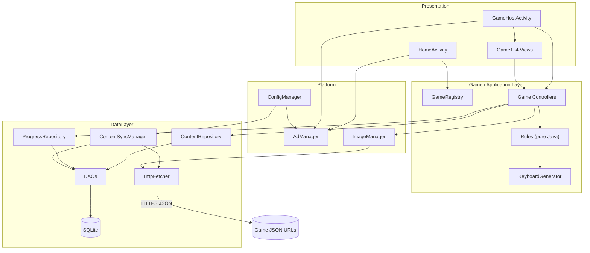

### 22.2 Application startup

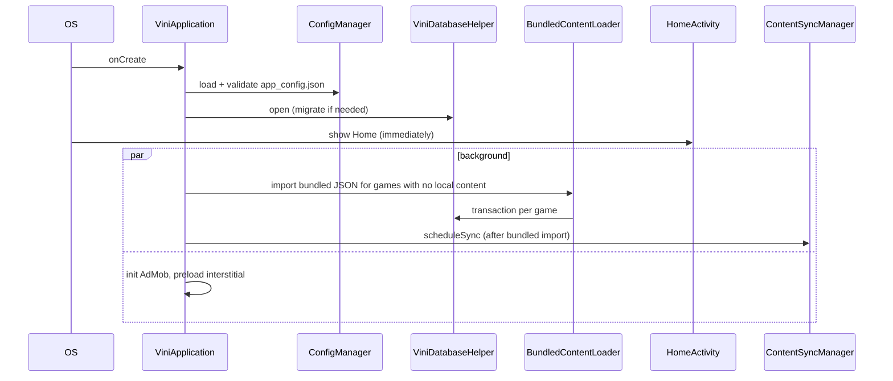

### 22.3 Content synchronization

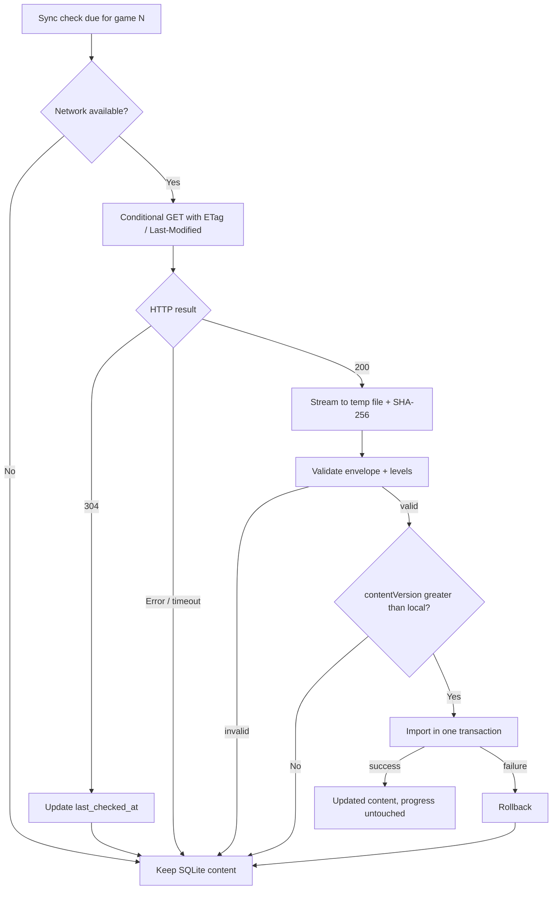

### 22.4 JSON → SQLite flow

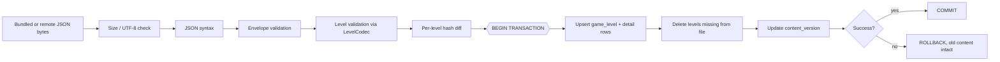

### 22.5 Game selection

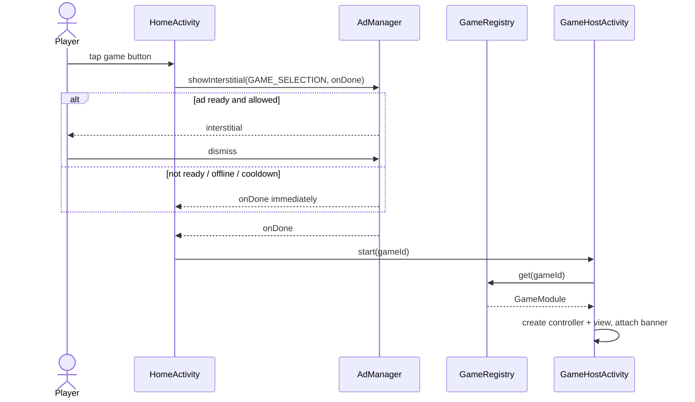

### 22.6 Game-layer architecture

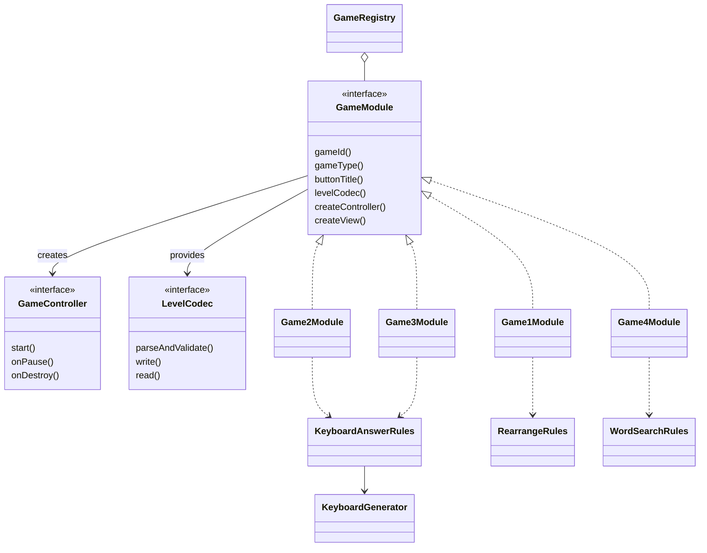

### 22.7 Game 2/3 keyboard generation

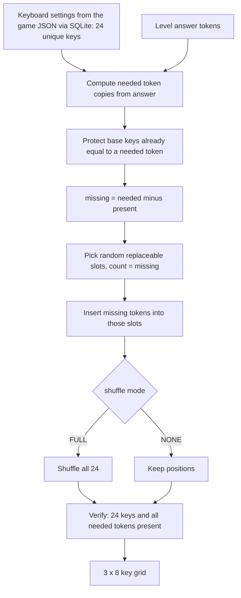

### 22.8 Progress persistence

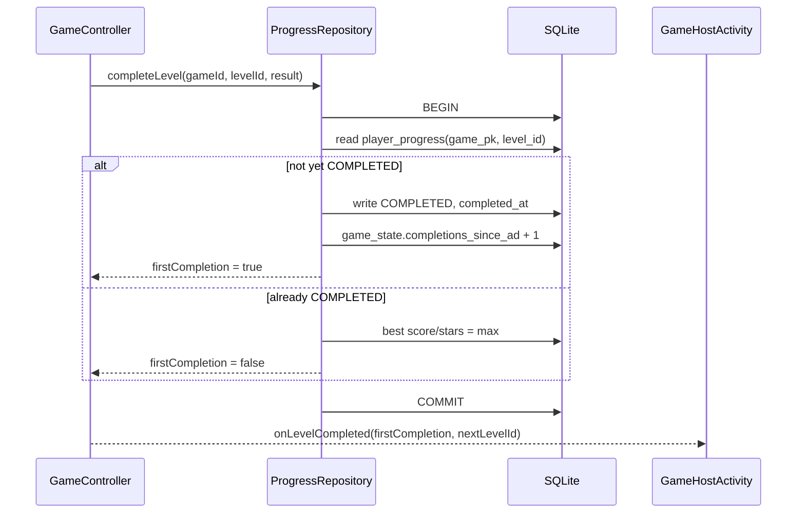

### 22.9 AdMob integration

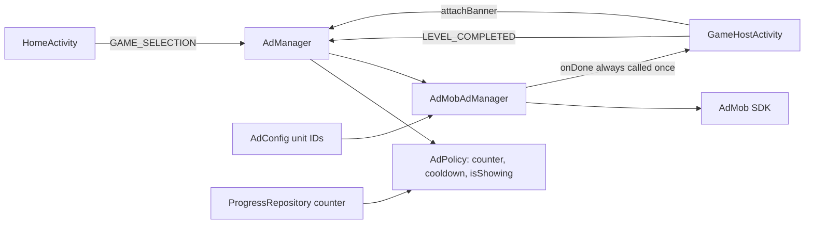

### 22.10 Content version update

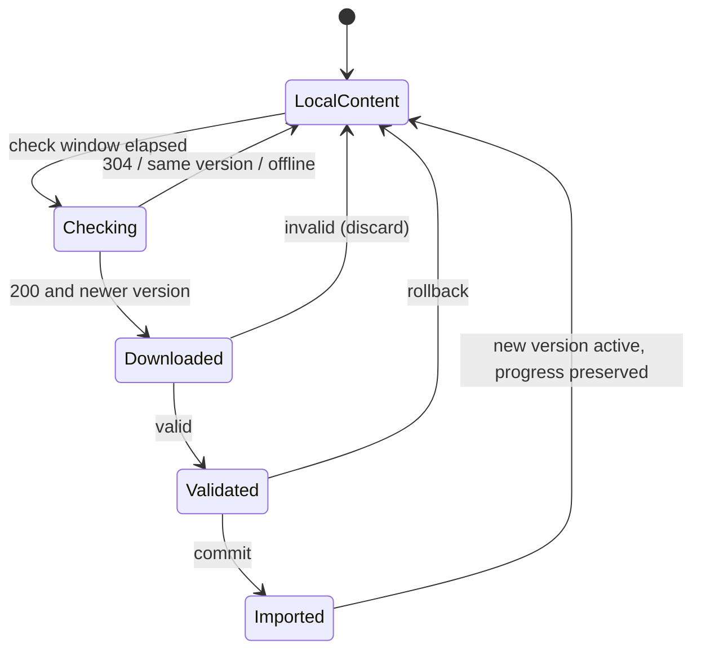

### 22.11 Data model (ER)

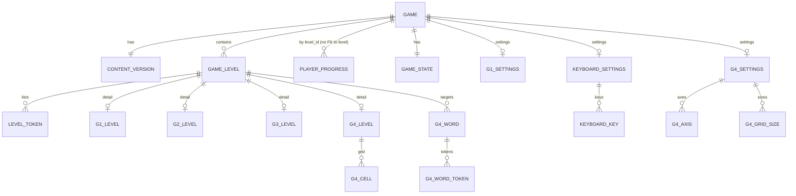

---

## 23. Architecture Decision Records

Each ADR separates what was **approved in the brief** from what is a **recommendation** here.

### ADR-001 — Java instead of Kotlin
- **Context:** Project rules mandate Java; Android Studio is the IDE.
- **Decision:** All application code in Java. [APPROVED]
- **Reason:** Stated requirement; also fits the small team skill set implied by the brief.
- **Consequences:** No coroutines/extension functions/data classes (immutable models are written by hand); use `Executors`; keep helper classes small to limit boilerplate. Third-party libs must have Java-friendly APIs (AdMob does).

### ADR-002 — JSON as remote content distribution format
- **Context:** Content authors must update puzzles without releasing the app; hosting is static (Firebase Hosting URLs given).
- **Decision:** Remote content is JSON, downloaded, validated and imported. [APPROVED]
- **Reason:** Human-readable, tool-friendly, trivially hosted, handles Unicode natively.
- **Consequences:** Need strict validation and a schema version; JSON never used as the runtime store; unverified match to the existing hosted files (A2).

### ADR-003 — SQLite as local runtime database
- **Context:** Fast level access, offline play, and progress must live somewhere durable.
- **Decision:** SQLite stores content and player progress. [APPROVED]. Access through framework `SQLiteOpenHelper` + DAOs (no Room). [RECOMMENDED]
- **Reason:** Transactions give atomic imports; relational constraints protect integrity; no extra dependency.
- **Consequences:** Hand-written SQL/DAOs and explicit migrations; instrumented tests needed for DB behavior.

### ADR-004 — Separate JSON URL per game
- **Context:** Games update at different rates; Game 3 content is heavier.
- **Decision:** One configurable URL per game; no shared content file. [APPROVED]
- **Reason:** Independent versioning, smaller downloads, fault isolation (one bad file can't block others).
- **Consequences:** Four sync pipelines (same code, per-game state); URL list lives in configuration, one transaction per game; Game 3's URL shape differs (A1).

### ADR-005 — Game-specific levels
- **Context:** The four games have different level structures.
- **Decision:** Common `game_level` header + game-specific detail tables + shared token table; per-game `LevelCodec`. [Hybrid = RECOMMENDED]
- **Reason:** Strong typing and constraints per game, no giant sparse table, no JSON blobs to parse at runtime, new games add tables not columns.
- **Consequences:** More tables (9 content tables); each new game requires DDL + a migration + a codec.

### ADR-006 — String-based playable tokens
- **Context:** Telugu syllable units are multi-code-point strings (`చం`); one displayed unit ≠ one `char`.
- **Decision:** All playable units are `String` tokens; normalized to NFC; never indexed by `char`. [APPROVED principle; NFC/validation details RECOMMENDED]
- **Reason:** Language-neutral correctness; avoids splitting grapheme clusters.
- **Consequences:** Token-list storage as rows; authors must supply tokenization (`words[].tokens`); rendering needs padding/font care.

### ADR-007 — Progress stored separately from JSON content
- **Context:** Content updates must never erase player progress.
- **Decision:** Progress in SQLite tables keyed by `(game_pk, level_id)`, no FK to level content; JSON contains no player data. [APPROVED separation; key/no-FK design RECOMMENDED]
- **Reason:** Content can be replaced, reordered or removed without data loss; stable IDs, not array positions.
- **Consequences:** Orphan progress rows can exist after level removal (intentionally retained); stats are computed against active levels; publishers must not reuse a `levelId` for a different puzzle.

### ADR-008 — Bundled JSON as initial/offline content
- **Context:** First launch may be offline; app must be playable immediately.
- **Decision:** Ship ≥ 2 levels per game in `assets/`, imported through the same pipeline. [APPROVED]; language-folder layout and Game 3 bundled images are [RECOMMENDED]
- **Reason:** One import code path; guaranteed baseline.
- **Consequences:** Increases APK size slightly; Game 3 needs bundled images (A13); bundled version can supersede old local content on app upgrade.

### ADR-009 — Centralized AdMob management
- **Context:** Ads must not leak into game logic; timing rules span games.
- **Decision:** `AdManager` interface + `AdMobAdManager` + pure `AdPolicy`; callbacks guarantee navigation continues. [APPROVED requirement; design RECOMMENDED]
- **Reason:** One place for IDs, readiness, retry, duplicate prevention, lifecycle; fake implementation for tests.
- **Consequences:** Hosts coordinate ads after controller callbacks; unresolved: consent/child-directed handling (TBD).

### ADR-010 — Language-neutral game engine
- **Context:** Hindi/Tamil/Kannada will follow Telugu.
- **Decision:** No language-specific branches; language differences live only in JSON content and configuration (`language` code, keyboards, optional font). [APPROVED]
- **Reason:** Adding a language = content + config, not code.
- **Consequences:** The language dimension (`language_code`) exists in the schema from day one; per-language keyboard design is a content responsibility; text-rendering quirks must be solved generically.

### ADR-011 — Game behavior/settings separated from level content and from app configuration
- **Context:** Repeating keyboards/animations in every level wastes bytes and invites inconsistency. The owner decided (2026-10-31) that keyboards — language-specific key sets — and other per-game settings must **not** live in `app_config.json`, and should be updatable remotely like content.
- **Decision:** Three-way split. (1) **Deployment configuration** (language, URLs, ad IDs/cadence, sync) in the bundled `app_config.json`. (2) **Game settings** (Game 1 animation, Games 2/3 keyboard, Game 4 axes/reverse/grid sizes/word range) as one **file-level `settings` block per game JSON** (Option C), imported into SQLite typed tables with the levels. (3) **Level content** in `levels[]`. The validator rejects settings keys inside levels. [APPROVED by owner: Option C; table design and validation rules RECOMMENDED]
- **Reason:** Single definition per game (never per level); no new URLs (ADR-004 intact); reuses validation, transaction, versioning, ETag, bundled fallback and offline behavior; language-specific data leaves the app configuration; a keyboard can be re-tuned (e.g., to hide which keys are answers, A5) without an app release.
- **Consequences:** Behavior-affecting data is now remotely changeable, so settings need rigorous validation, atomic replacement and rollback; extra tables and codec methods; remote data can only **select** among behaviors the installed app implements, so an unknown enum value rejects the file for older apps (risk 21, T25); the brief's wording "configuration" for keyboard/animation is realized as game-level settings delivered with content, while still not repeated per level (R10, R11).

### ADR-012 — Game 2 and Game 3 share a configurable 24-key keyboard mechanism
- **Context:** Both games use an identical 3×8 keyboard with answer injection.
- **Decision:** One `KeyboardGenerator` + `KeyboardAnswerRules` and one shared `KeyboardSettings` model/tables (`keyboard_settings`, `keyboard_key`), populated independently from `settings.keyboard` in `game2.json` and `game3.json`. [APPROVED requirement; algorithm RECOMMENDED]
- **Reason:** No duplicate logic; one set of tests; guaranteed 24 keys and answer availability by construction (§11.2 proof).
- **Consequences:** Duplicate-key/`keyReuse`/shuffle semantics (A5–A7; approved: consumable keys, full shuffle, joined-string equality) apply to both games; the 24-key invariant is enforced at import validation rather than at app startup; the two games can still publish different keyboards.

### ADR-013 — Game 1 animation configured once per game rather than per level
- **Context:** Animation is game behavior, not level content.
- **Decision:** `animation` enum declared once in `settings.animation` of `game1.json`, stored in `g1_settings`; absent from every level. [APPROVED]
- **Reason:** Consistency; smaller JSON; the validator rejects per-level animation keys.
- **Consequences:** The animation can be switched among implemented types by a content update; a new animation type needs an app release first; the trigger semantics (A4) must still be defined.

---

## 24. Non-Goals (v1) [APPROVED]

User accounts; cloud synchronization of progress; multiplayer / real-time multiplayer; backend game generation; executable logic in JSON; diagonal word search in the initial release (extension point retained).

Additional non-goals **[RECOMMENDED, need approval]**: remote-updatable configuration; background (WorkManager) sync; crash-reporting/analytics SDKs; persisting mid-level state to SQLite; in-app language switching UI (until decided); in-app purchases / ad removal.

---

## 25. TBD Register

| ID | Item | Why it matters | Recommendation (not approved) |
|---|---|---|---|
| T1 | Verify real hosted JSON for the four URLs (A2) | Schema may differ | Fetch and adapt envelope/field names before Phase 2 |
| T2 | `minSdk`, `targetSdk`, `applicationId`, Gradle/AGP versions ("approved Android configuration") | Build setup | minSdk 24 (Telugu shaping/fonts, AppCompat); targetSdk per current Play requirement at release |
| T3 | Score & star formulas; attempts definition | Rewards/progress display | Simple attempts-based stars via `ScoringPolicy` |
| T4 | Level unlock rules, replay, "all levels completed" UX | Navigation | Sequential unlock, completed levels replayable |
| T5 | Game 1 animation trigger; wrong-order feedback; auto-check vs button | UX | Auto-check; animate on completion |
| T6 | `keyReuse` default; tapped-key behavior; wrong-answer feedback | Games 2/3 UX | Consumable keys; return on tap of filled slot |
| T7 | Alternative-segmentation answer acceptance (joined-string equality) | Validation rule | On |
| T8 | Base keyboard content incl. distractors (A5) | Fairness/giveaway | Include realistic syllable distractors; FULL shuffle |
| T9 | Game 4: reverse selection allowed; target word format; wrong-selection feedback | Rules | `allowReverse=true`; token lists |
| T10 | Interstitial counter scope, cooldown value, replays (A10) | Ads | Per-game, first-time completions, small cooldown |
| T11 | UMP consent / child-directed treatment / AdMob account details | Release blocking | Decide before store submission |
| T12 | Image host, relative URL rule, bundled images, size/count caps, prefetch policy (A1, A13) | Game 3 | `image.asset` for bundled; https absolute URLs |
| T13 | Non-game UI strings policy (A11) and Home titles text/language | Conflicts with hardcoding rule | Allow minimal `strings.xml` chrome strings |
| T14 | Portrait-only vs rotation | State handling | Portrait lock |
| T15 | Language selection UX and bundled-asset layout `games/<lang>/` (A12) | Future languages | Config `activeLanguage` for v1; per-language folders |
| T16 | Strict vs lenient import policy (§7.1) | Content resilience | Strict |
| T17 | Content-level reset-progress mechanism | Content ops | None in v1; new `levelId` instead |
| T18 | Numeric caps: file size, levels/file, tokens/level, token length | Security/perf | As proposed in §14/§19 |
| T19 | Hosting `Cache-Control` for JSON; optional manifest | Update latency | `no-cache` / short max-age |
| T20 | Auto Backup of DB; crash reporting; R8 shrinking | Ops | Backup DB yes; none; shrink on |
| T21 | Fonts per language (system vs bundled) | Rendering | Test on low-end devices first |
| T22 | Performance/startup budgets and reference devices | Acceptance | Define in Phase 1 |
| T23 | Game removal purge policy | Storage | Keep data |
| T24 | Test-only dependencies (org.json, Espresso, optional MockWebServer) | "No unnecessary dependencies" | Allow test-scope only |
| T25 | Evolution of settings enums (new animation/axis/shuffle values) vs older installed apps; optional `minAppVersion` field | Unknown enum rejects the file on older apps | Release the app before publishing new enum values; consider a `minAppVersion` envelope field |

---

## 26. Risks and Mitigations

| # | Risk | Likelihood / Impact | Mitigation |
|---|---|---|---|
| 1 | Hosted JSON differs from this schema (A2) | High / Medium | Verify first (T1); adapter in `LevelCodec` if needed |
| 2 | JSON schema changes over time | Medium / High | `schemaVersion` gate; strict validator; fixtures per version |
| 3 | Content corruption / invalid levels | Medium / High | Validate-all-before-write, transaction, hash, keep last good |
| 4 | Invalid or reused `levelId` | Medium / High | Unique-ID validation; documented rule: never reuse an ID for a different puzzle |
| 5 | Progress loss (migration bug, corruption) | Low / High | Progress never in content transactions; migration tests; recovery path |
| 6 | Large downloads / metered data | Medium / Low | Conditional GET, per-game files, size caps, check interval |
| 7 | Image cache growth | Medium / Medium | Disk quota + LRU; bounded prefetch |
| 8 | Unicode/String mishandling (char slicing, clipped glyphs) | Medium / High | Token rules (§10), NFC, grid/keys padding, tests with real Telugu, review for `charAt` usage |
| 9 | SQLite migrations | Medium / High | Ordered tested steps; progress migrated not dropped |
| 10 | Keyboard randomization yields invalid layout | Low / High | Provable algorithm (§11.2), post-condition assertion, seeded tests |
| 11 | Duplicate answer tokens / ambiguity | Medium / Medium | Defined policy (T6), tests |
| 12 | Answer tokens conspicuous among keys | Medium / Medium | Full shuffle + curated base keyboard (T8) |
| 13 | AdMob dependency (policy violations, fill, consent, SDK API changes) | Medium / High | Single abstraction, test IDs in debug, consent decision (T11), never block navigation |
| 14 | Network failure everywhere | High / Low | Offline-first design, silent retry |
| 15 | Future language support (fonts, input units, keyboards) | Medium / Medium | Language-neutral engine; per-language config; test one more script early (e.g., Hindi) |
| 16 | Adding new game types | Medium / Low | Module + codec extension point, migration per game |
| 17 | Game 3 offline first run lacks images | Medium / Medium | Bundled images (A13/T12) |
| 18 | 8-column keyboard too cramped on small screens | Medium / Medium | Responsive key size; test 360 dp width; configurable rows/columns |
| 19 | Static-host caching delays updates | Medium / Low | Cache headers (T19); version check authoritative |
| 20 | Scope creep (score/stars/unlock undefined) | Medium / Medium | Resolve T3–T5 before Phase 5 |
| 21 | A remote settings change affects every level of a game at once (bad keyboard, unknown enum for an older app) | Medium / High | Settings validated before import; atomic replace with rollback; bundled copy as fallback; unknown enum rejects the file so older apps keep previous content (T25); publish via a test copy first |

---

## 27. Recommended Implementation Sequence

Each phase: explain → implement agreed scope only → build + run relevant tests → report → get approval before the next.

| Phase | Scope | Verification |
|---|---|---|
| 0 | Resolve blocking TBDs (T1, T2, T13, T14, T16), confirm hosted JSON shape; repo/project skeleton (package layout, Gradle, no features) | Builds; empty app launches |
| 1 | Deployment config (`ConfigManager`, `app_config.json`: languages, URLs, ads, sync — no game settings), util classes, `Logger`, `AppExecutors` | JVM tests: config validation |
| 2 | Models, JSON envelope + per-game validators/codecs, token normalization; sample bundled JSON (2 levels × 4 games) | JVM tests with valid/invalid fixtures |
| 3 | SQLite schema, helper, DAOs, importer with transactions, bundled loader, repositories | Instrumented DB tests incl. rollback, progress preservation |
| 4 | Progress: `ProgressRepository` idempotent completion, derived queries, migration scaffold | DB + JVM tests |
| 5 | Game registry/modules, `HomeActivity`, `GameHostActivity` shell | UI smoke test |
| 6 | Keyboard generator + Games 2 (rules, controller, view) | Unit tests (seeded), manual play |
| 7 | Game 3 (image manager, cache, bundled images) | Image cache tests, offline test |
| 8 | Game 1 (drag/drop, animation) | Unit + manual/UI test on device |
| 9 | Game 4 (grid view, selection, matching) | Unit + UI test |
| 10 | Content sync (HTTP, conditional GET, version policy, failure paths) | Integration tests with fake server |
| 11 | `AdManager` (AdMob test IDs), policy, banner, interstitial flows, consent (if decided) | Fake-ad unit tests + manual with test ads |
| 12 | Hardening: error screens, performance pass on low-end device, migration test, R8, release checklist | Full regression, documented results |

---

## 28. Summary for Review

**Architecture in one paragraph.** A layered Java Android app: custom-View UI and one `GameHostActivity` → per-game controllers → pure-Java rules (including a shared Game 2/3 keyboard generator) → repositories → framework SQLite DAOs. Four game modules register in a `GameRegistry` (adding Game 5 = one module + one codec + DDL). Four per-game JSON URLs feed one generic pipeline — conditional GET, strict validation, per-game transactional import — into a normalized SQLite schema (common level header + game-specific tables + shared ordered-token rows). Player progress is separate, keyed by stable `(game, levelId)` with idempotent completion. Deployment configuration (language, URLs, ad IDs, sync) is a bundled file; per-game settings (animation, keyboards, search rules) travel in each game's JSON as a file-level `settings` block, never per level. Ads go through one `AdManager` whose callback always lets navigation continue. Everything is offline-first.

**Dependencies introduced:** only AndroidX AppCompat (standard) and the AdMob SDK at runtime; JUnit, an `org.json` test artifact and AndroidX Test/Espresso at test scope (T24).

### Decisions needing your approval (priority order)

1. **Verify/adjust the hosted JSON shape** (T1) — I could not fetch the URLs; the schema in §5 is proposed.
2. **Strict all-or-nothing import** per game file (T16).
3. **Progress kept on content change; removed levels keep progress rows** (§9.3).
4. **Bundled `app_config.json` for deployment config only** (no remote config), with `assets/games/<lang>/` layout (A12/T15). *Revised:* keyboards and other per-game settings ship in each game's JSON `settings` block (Option C), not in `app_config.json`.
5. **Keyboard semantics:** consumable keys vs reusable, full shuffle, joined-string answer equality (T6–T8).
6. **Ad counting:** per-game, first-time completions only, optional cooldown; consent/child-directed decision (T10, T11).
7. **Minimal non-game UI strings** allowed despite the hardcoding rule (T13).
8. **SQLiteOpenHelper instead of Room; `org.json`, `HttpURLConnection`, own image cache** — no extra libraries (ADR-003).
9. **Portrait lock** (T14); **minSdk/targetSdk** (T2).
10. **Game 4 target words as token lists** with optional positions; reverse selection (T9).
11. **Game 3 bundled images via `image.asset`** and image host/caps (T12).
12. Definitions for score, stars, attempts, level unlock (T3–T4).

### Top risks

Hosted JSON mismatch; Unicode/glyph-clipping bugs; progress safety across migrations; conspicuous answer keys in the keyboard; Game 3 offline first-run images; AdMob consent/policy; undefined scoring scope.

### Document control

No application code, no GitHub commits, original requirements file untouched. This document will be updated as decisions in §25 are resolved.
